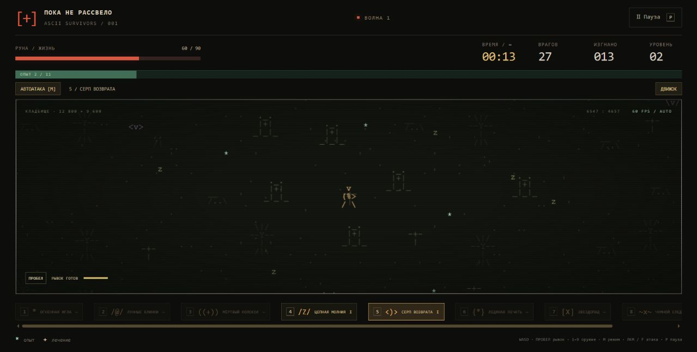

# Пока не рассвело · ASCII Survivors

Бесконечная браузерная арена на JavaScript и Canvas: шесть героев, восемь видов оружия и толпы нечисти, нарисованные ASCII-символами. Работает без сборки, библиотек и внешних ресурсов. Управление с клавиатуры, мыши и сенсорного экрана.



## Запуск

Скачайте репозиторий через **Code → Download ZIP**, распакуйте архив и откройте `index.html` в браузере.

Либо запустите локальный сервер из папки проекта, если установлен Python:

```sh
git clone https://github.com/toxic8yte/ascii-survivors.git
cd ascii-survivors
python -m http.server 4173
```

Откройте <http://127.0.0.1:4173/>. Node.js нужен только для проверок и измерений; самой игре он не требуется.

Для размещения как статического сайта подходят файлы `index.html`, `style.css`, `core.js`, `renderer.js` и `game.js`. В GitHub Pages можно выбрать ветку `main` и папку `/ (root)` в **Settings → Pages → Deploy from a branch**.

## Что есть в игре

Время забега не ограничено. Волны, число появляющихся врагов, их здоровье и урон растут; жнец возвращается каждые 2,5 минуты возраста волн.

Размер мира — **12 800 × 9 600** игровых единиц: по каждой стороне в четыре раза больше исходной карты, по площади — в 16 раз. Герой начинает в центре, декорации создаются только рядом с камерой, кеш ограничен 36 участками. Звёздочки опыта и аптечки используют отдельные светлые цвета и рисуются поверх боевых эффектов.

Зелёные `*` дают опыт, красные `[+]` лечат. Уровень останавливает бой и предлагает три дара. Первый выбор всегда содержит новое оружие. Близкие осколки объединяются с сохранением всего опыта; лечение остаётся на поле до двух минут, одновременно хранится до 128 аптечек.

## Управление

- WASD / стрелки — движение; пробел — рывок.
- **M** или кнопка режима — автоматические атаки / ручное управление.
- В авто-режиме работает **всё найденное оружие**.
- В ручном режиме **1–9** выбирают слот, **ЛКМ или F удерживаются для атаки**. Курсор задаёт прицел; без курсора атака идёт по последнему направлению движения.
- 1 игла, 2 клинки, 3 колокол, 4 молния, 5 серп, 6 лёд, 7 метеорит, 8 яд, 9 пока пуст. Ненайденное оружие не выдаётся нажатием цифры.
- На экране улучшений 1 / 2 / 3 по-прежнему выбирают дар.
- P / Escape — пауза; R — новый забег. Героя можно сменить перед стартом, из паузы и после поражения.
- На телефоне: джойстик, рывок, кнопка атаки в ручном режиме; касание поля задаёт прицел. Слоты оружия нажимаются и прокручиваются горизонтально.

В ручном режиме игла и серп летят к прицелу, молния выбирает первую цель в направлении прицела, метеорит и яд ставятся в выбранную точку в пределах дальности. Колокол и лёд действуют вокруг героя, клинки делают направленный взмах. Перезарядки сохраняются при смене режима и оружия.

## Герои и арсенал

| Герой | Начальное оружие | Особенность |
| --- | --- | --- |
| Мара, охотница | Огненная игла | Сбалансированные параметры |
| Тень, дуэлянт | Лунный клинок | Рывок каждые 2,6 секунды |
| Искра, ведьма | Цепная молния | Атака нескольких целей |
| Север, страж | Ледяная печать | 150 здоровья, замедление врагов |
| Руна, следопыт | Серп возврата | Самый быстрый бег |
| Мор, алхимик | Чумной след | Большой радиус сбора опыта |

Всего 8 видов оружия с четырьмя ступенями, 16 даров и 5 видов врагов. Пассивные дары усиливают урон, частоту атак, снаряды, движение и выживаемость. Декорации не мешают движению. Скрытая вкладка автоматически ставит игру на паузу.


## Проверка нагрузки

Перед стартом включите **«Нагрузочный тест»**: герой становится неуязвимым, весь арсенал и пассивные дары сразу максимально улучшены, рекорд выживания не меняется. Обычная арена сохраняет здоровье и постепенное получение оружия.

Выберите предел одновременно живых врагов: 1 000 / 3 000 / 6 000 / 12 000 / 24 000. По умолчанию 6 000. Достигнув предела, игра ждёт свободных мест; враги не исчезают для поддержания FPS. Расталкивание толпы проверяет ограниченное число соседей, чтобы не делать попарный перебор всей толпы.

Когда на поле больше тысячи врагов, совпадающие позиции в одной ASCII-клетке отрисовываются одним представителем. Все враги остаются отдельными объектами симуляции и получают урон. «Видимые группы» показывает число отрисованных представителей в кадре; боссы рисуются отдельно. Это сокращает повторную отрисовку плотной толпы.

Кнопка **«Движок»** показывает текущее и максимальное число врагов, FPS, средний интервал кадра и P95 за последние 180 кадров, затраты симуляции и отрисовки, снаряды и дроп. Интервал кадра включает ожидание следующего обновления экрана; затраты симуляции/отрисовки показывают работу JavaScript и отправку команд Canvas, а не отдельное время GPU.

Время забега считает активные секунды. «Обработано игрой» показывает время физических шагов. При сильном падении FPS оно может отставать: догоняющая симуляция ограничена 100 мс на кадр. Возраст волн опирается на активное время и продолжает увеличивать сложность.

**«Нагрузка +5 минут»** усиливает волны до соответствующего возраста, не прибавляя фиктивное время к забегу. Шесть нажатий позволяют быстро проверить волны как после получаса. **«Сохранить замеры JSON»** выгружает параметры и последние 3600 секунд замеров. В паузе замеры не накапливаются. Проверять частоту следует в видимой вкладке: фоновые вкладки браузер может замедлять.

## Реализация и проверки

`core.js` — независимая симуляция, воспроизводимый генератор и пространственная сетка. `renderer.js` — ASCII-атлас, ограниченный кеш декораций и интерполяция. `game.js` — ввод, интерфейс, метрики и обновление по частоте экрана без лимита 30 FPS. Физика работает с фиксированным шагом 1/60 секунды. Системная настройка уменьшения движения убирает вспышку при уроне.

- `node verify.cjs` проверяет бой, ручной/автоматический режим, слоты, получение оружия, героев, бесконечное время, слияние опыта и кеш отрисовки.
- `node benchmark.cjs` измеряет 120 шагов после прогрева для толп 1 000–24 000 и проверяет 30 минут **ускоренной симуляции** с шагом 50 мс и пределом 1 000 врагов. Результат записывается в `benchmark-results.json`.
- Эти измерения Node **не включают отрисовку и GPU** и не заменяют получасовой браузерный тест. Реальную частоту на конкретном устройстве показывает панель в игре.

Вариант дальнейшего сетевого кооператива разобран в [COOP_PLAN.md](COOP_PLAN.md). Сетевой режим в текущей сборке ещё не реализован.
