# ASCII Survivors · Пока не рассвело

[](https://github.com/toxic8yte/ascii-survivors/actions/workflows/pages.yml)

Бесконечная браузерная арена на JavaScript и Canvas: **30 героев, 58 типов врагов, 33 вида оружия, 22 пассивных дара, 31 эволюция, набор 5+5 и постоянные улучшения и мегабосс после 10-й минуты**. Герои открываются за золото, сундуки предлагают одну награду из трёх. Персонажи, нечисть и эффекты нарисованы ASCII-символами. Работает без сборки, библиотек и внешних ресурсов. Управление с клавиатуры, мыши и сенсорного экрана.

**[Играть в браузере →](https://toxic8yte.github.io/ascii-survivors/)**

[Полный набор эволюций и девять новых связок](docs/EVOLUTION_COVERAGE.md).

[Редкости, выбор усилений, изгнание/платный реролл и новое оружие](docs/UPGRADES.md). [Замедление прокачки и аудит всего арсенала](docs/PROGRESSION_TUNING.md).

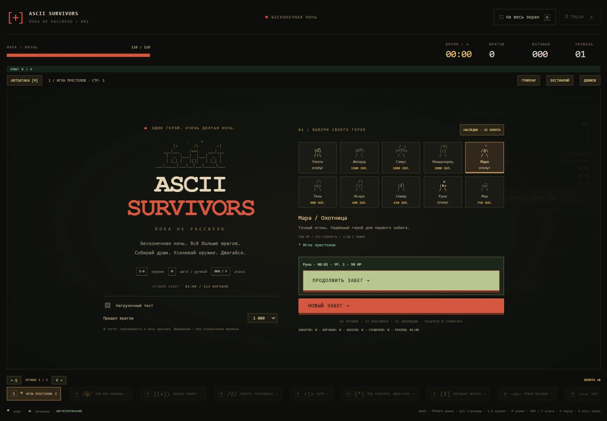

## Запуск

Скачайте репозиторий через **Code → Download ZIP**, распакуйте архив и откройте `index.html` в браузере.

Либо запустите локальный сервер из папки проекта, если установлен Python:

```sh
git clone https://github.com/toxic8yte/ascii-survivors.git
cd ascii-survivors
python -m http.server 4173
```

Откройте <http://127.0.0.1:4173/>. Node.js нужен только для проверок и измерений; самой игре он не требуется.

## GitHub Actions и публикация

Workflow [Test and deploy game](.github/workflows/pages.yml) запускается при push в `main`, при pull request в `main` и вручную через **Actions → Test and deploy game → Run workflow**. Сначала проверяется синтаксис JavaScript и выполняются все 17 наборов проверок; после успешных проверок `main` публикуется в GitHub Pages. Pull request запускает только проверки.

В **Settings → Pages → Build and deployment → Source** выбран **GitHub Actions**. Для копии репозитория нужно включить тот же источник публикации. Порядок настройки описан в [документации GitHub](https://docs.github.com/en/pages/getting-started-with-github-pages/using-custom-workflows-with-github-pages).

В артефакт сайта попадают только `index.html`, `style.css`, `enemy-roster.js`, `content-data.js`, `enemy-system.js`, `catalog.js`, `combat.js`, `core.js`, `progress.js`, `renderer.js` и `game.js`. Браузер выполняет игру на устройстве игрока; Actions проверяет файлы и публикует статический сайт. Сервер сетевого кооператива в этой версии отсутствует.

При упаковке к адресам CSS и JavaScript добавляется SHA коммита. После обновления страницы браузер получает ресурсы той же версии, что и HTML, вместо старых файлов из кеша. Локальный запуск не требует упаковки.

## Что есть в игре

Время забега не ограничено. Обязательная численность 666–999 отменена: до 06:00 цель плавно растёт с 24 до 150, после — на 135 врагов в минуту. В обычной фазе к 08:00 цель около 420, к 10:00 — 690, защитный потолок — 2 000. С 02:00 первые 10 секунд минуты дают наплыв (+12% цели до шестой минуты, +25% после), последние 12 секунд — передышку. После 06:00 группы пополняются быстрее, в пул одновременно входят быстрые, тяжёлые и особые враги. Стрелки ограничены 24, особые 60, элиты 45; до шестой минуты действуют меньшие квоты. Здоровье обычных врагов после 06:00 получает дополнительный множитель +20% в минуту, скорость — до +15%. С обычных врагов опыт выпадает с шансом 50%, с боссов гарантированно; нулевая награда не создаёт кристалл. Джек-фонарь получил 105 базовых HP, 16 контактного урона, интервал залпа 2,8 секунды и скорость шаров 220. Обычные боссы получили вдвое больше базовых HP, мегабоссы — на 80% больше. Далёкие обычные враги исчезают без опыта, боссы возвращаются за край обзора с прежним здоровьем. Нагрузочный режим сохраняет отдельный предел до 24 000 и гарантированные кристаллы. Подробнее: [баланс и сравнение прогонов](docs/BALANCE_TUNING.md).

Размер мира — **12 800 × 9 600** игровых единиц: по каждой стороне в четыре раза больше исходной карты, по площади — в 16 раз. Герой начинает в центре, декорации создаются только рядом с камерой, кеш ограничен 36 участками. Звёздочки опыта и аптечки используют отдельные светлые цвета и рисуются поверх боевых эффектов.

Голубые `*` дают опыт, красные `[+]` лечат. Уровень останавливает бой и предлагает три дара. Первый выбор всегда содержит новое оружие. Близкие осколки объединяются с сохранением всего опыта; лечение остаётся на поле до двух минут, одновременно хранится до 128 аптечек.

## Лесная арена

В выборе **«Арена»** доступны **«Лес без возврата»** и **«Кладбище»**. Лес открыт сразу: перекрёсток, редкие сосны и дубы, камни, пни, пруды и заброшенный сад. Размер — 12 800 × 9 600; дороги остаются свободными, крупные деревья и камни имеют коллизию. Пруды и цветы — проходимые декорации. Ориентиры повторяются по миру, карту сокровищ дополняют тропы и пруды.

Состав волн в лесу задан по минутам в [data/stages.json](data/stages.json): сначала мыши, затем зомби и скелеты, после — призраки, оборотни, мумии и тяжёлая нечисть нашего бестиария. После 30:00 продолжается цикл последних шести составов. Темп, давление после шестой минуты, квоты особых врагов, боссы и сундуки используют наш баланс. Старые сохранения без карты продолжаются на кладбище; новые сохраняют выбранную арену. Подробнее: [устройство леса и расписание волн](docs/FOREST.md).

## Песочница для проверки оружия

На стартовом экране включите **«Песочница: любой герой и оружие» → «Настроить тест»**. Доступны все 30 героев без покупки, 33 оружия с выбором ранга, эволюция, одна пассивка и её ранг, манекен или любой из 58 противников, 1 / 5 / 20 целей. После зачистки цели появляются снова. Кнопка **«Песочница»** сверху позволяет сменить настройку и начать новый тест.

В тесте герой неуязвим, нет случайных волн, автоматических боссов и прокачки. Кошелёк, покупки, статистика и сохранённый обычный забег остаются прежними. Нагрузочный тест с полным арсеналом и массовыми волнами — отдельный режим.

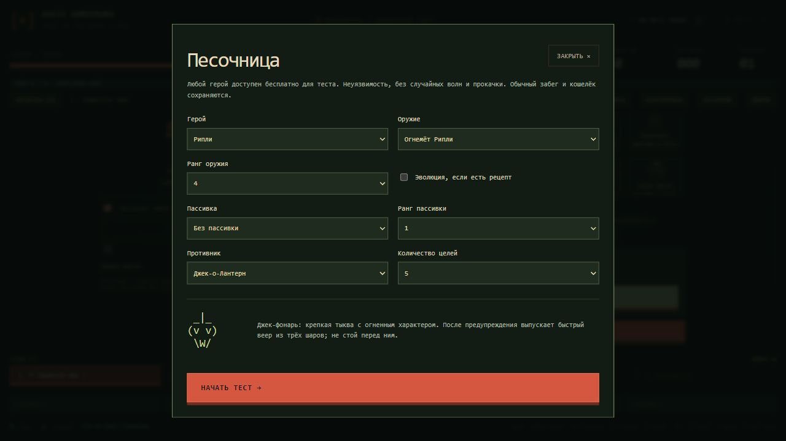

Враги получили 58 разных силуэтов. При больших толпах далёкие рядовые противники рисуются компактными значками; рядом с героем, у элит и боссов сохраняется полный рисунок. Сундук предлагает три награды из доступных категорий: опыт, золото, оружие, пассивка; готовая эволюция получает приоритет. Забирается одна награда.

## Управление

- WASD / стрелки — движение; пробел — рывок.
- **M** или кнопка режима — автоматические атаки / ручное управление.
- В авто-режиме работает **всё найденное оружие**.
- **1–5** — пять найденных оружий по порядку получения. **Q / E** переключают страницы только в нагрузочном тесте или старом сохранении с большим набором; автоатака использует весь найденный арсенал.
- В ручном режиме **ЛКМ или F удерживаются для атаки**. Курсор задаёт прицел; без курсора атака идёт по последнему направлению движения. Ненайденное оружие не выдаётся нажатием цифры.
- На экране улучшений 1 / 2 / 3 по-прежнему выбирают дар.
- **G** или «На весь экран» — развернуть игровое поле; повторное G, «Свернуть» или Escape возвращает обычный вид.
- P — пауза; Escape в обычном виде тоже ставит игру на паузу. R — новый забег. Героя можно сменить перед стартом, из паузы и после поражения.
- На телефоне: джойстик, рывок, кнопка атаки в ручном режиме; касание поля задаёт прицел. Слоты оружия нажимаются и прокручиваются горизонтально.

В ручном режиме игла и серп летят к прицелу, молния выбирает первую цель в направлении прицела, метеорит и яд ставятся в выбранную точку в пределах дальности. Колокол и лёд действуют вокруг героя, клинки делают направленный взмах. Перезарядки сохраняются при смене режима и оружия.

Страница использует всю ширину окна без ограничения 1500 px. В развёрнутом виде Canvas занимает всю область просмотра, а здоровье, таймер, кнопки и оружие размещены поверх поля. Размер рисунка пересчитывается автоматически. Если браузер разрешает Fullscreen API, скрывается и интерфейс браузера; в остальных случаях поле заполняет окно вкладки. Разворачивание доступно до старта и во время игры, не заменяет сохранённый забег.

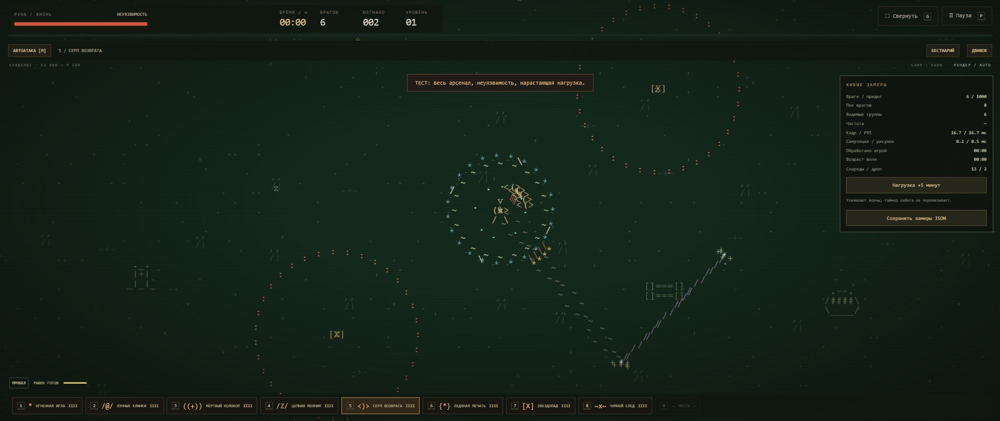

## Герои и арсенал

| Герой | Начальное оружие | Цена | Особенность |
| --- | --- | ---: | --- |
| Электра Ивановна / Электроведьма | Карманная катушка Теслы | 500 | электроведьма «Живёт на пятом, колдует через щиток. Если в подъезде моргнул свет — значит кто-то снова не поздоровался.» |
| Фрео / Холодильный мастер | Сигил Деда Мороза | 650 | «Когда-то чинил кондиционеры. Теперь чинить приходится всё после него.» |
| Руна / Следопыт | Серп | 300 | «Северная следопытка. Бросает серп туда и обратно, потому что покупать второй считает расточительством.» |
| Мор / Чумной доктор | Язва Чужого | 750 | «Проклятый чумной доктор. Оставляет за собой ядовитый след и тянет души к себе, будто снова идёт старый недобрый обход. |
| Тень / Дуэлянт | Кольца мясорубки | 400 | Если видишь Тень — это уже устаревшая информация.» |
| Калибр / Охотник | Поджигатор 3000 | Бесплатно | «Стреляет туда, куда целится. На фоне остальных это уже почти суперспособность.» |
| Энцо Арбиторре / Ассасин | Ножи 47-й аргумент | 450 | Энцо Арбиторре ассасин «Быстро бегает, коротко исчезает и решает большинство конфликтов ножом. Кодекс запрещает убивать невиновных. Про остальных написано мелким шрифтом.» |
| Бабка с топором / Топорный мастер | Топорики Т-77 | 2000 | Рубит с плеча, объясняет потом. Метательные топоры и +10% урона. |
| Брюс Не-Уэйн / Рыцарь без бюджета | Лапки бэтмена | 700 | Денег нет, машины нет, скуф, живёт с мамой — зато мыши настоящие. +30 здоровья и −10 скорости относительно прежнего героя. |
| Кадильщик / Служитель | Кадило на цепи | 550 | Рассыпается в комплиментах. Говорит, что кадило ему подбросили. Ближняя аура, 120 здоровья и +1 брони. |
| Вольт / Замыкатель | Электропистоль Вольта | 850 | Нервный, быстрый, вооружённый электропистолетом. Сидеть спокойно физически не может.» |
| Светоч Лана / Светоч | Жезл Светоча Зарты | 1200 | Несёт свет в массы и золото в карманы. Почему пожертвования автоматически летят именно к ней — церковь не комментирует. Уникальный жезл поражает большую область и оставляет священную метку с длительным уроном. |
| Стигмабой / Носитель печати | Библия Джона Кика | 950 | Печать качества потустороннего сервиса. Вращающиеся книги и +1 брони. |
| Рипли / Утилизатор | Огнемёт Рипли | 1000 | «Если проблема шипит, капает кислотой или числится активом корпорации — её лучше сжечь.» |
| Самус Аркан / Охотница за наградой | Пушка Чозо | 1800 | Если дверь не открывается — стреляй в неё другим цветом. Пушка Чозо заряжает пробивающую плазму. +2 брони и два дополнительных заряда. |
| Лунакраса / Ночная смена | Летучая мышь из Китая | 900 | Уже вышла, пока остальные только собираются. Красная летучая мышь бомбит вращающийся сектор. |
| DJ Харон / Диджей преисподней | Стигийский мегафон | 800 | Бывший перевозчик, теперь вещает из преисподней. Перевозит души больше не на лодке, а по громкой связи. Начинает со Стигийского мегафона. |
| Крипто ди Скамус / Могильный инвестор | Праща пращуров | 1600 | Обещает рост до могилы. Праща, широкий сбор душ и +20% базового золота. |
| Мгла / Мутные схемы | Крещёная минералка | 1050 | Напускает туман на финансовые и боевые перспективы. Святые лужи и быстрый отход. |
| Резонанс / Громкий случай | Стигийский мегафон | 1400 | Отзывается даже на чужие проблемы. Волна колокола с +15% области атак. |
| Иней / Морозный осадок | Сигил Деда Мороза | 1100 | Выпал из прогноза погоды. Ледяное кольцо с +10% области атак. |
| Жнец / Сезонный работник | Топорики Т-77 | 1750 | Работа сдельная, оплата душами. Метательные топоры наносят на 15% больше урона. |
| Око / Зрячий отдел | Фаерболл Балрога | 1300 | Смотрит с огоньком. Огненные шары, +10% урона и большой радиус сбора душ. |
| Джедай-Флагеллант / Обратная связь | Кнут Новой надежды | 1150 | Каждый разговор возвращается к кнуту. Надёжный боец ближней и средней дистанции. |
| Некроморф / Ксенопаразит | Язва Чужого | 1250 | Язва Чужого и кража жизни: возвращает 2% фактически нанесённого кислотой урона, максимум 1 здоровья за попадание, с запасом лечения 2 HP и восстановлением запаса на 0,6 HP/с. |
| Фримен / Физик-практик | Монтировка Фримена | 2200 | Начинает с монтировкой для ближнего боя. 100 здоровья и +2 брони. |
| Бездна / Провал по плану | Игрушечный пентакль | 2600 | Смотрит в ответ и чистит арену. Пентаграмма с редкими мощными вспышками; между ними двигайся. |
| Ван Дер Хельсинга / Охотник на нечисть | Арбалет Ван Дер Хельсинга + Скандинавский пинбол | 1500 | Арбалет + Рикошетящие руны и +10% области атак. |
| Волтбой 13 / Выходец из Убежища | Плазменный миниган Маркус | 3200 | Повторить, пропустить, уничтожить Плазменный миниган Маркус |
| ROOT / Админ без выходных | Молот Бора | 5000 | Права есть, выходного нет. Тяжёлый молот, +2 брони и +10% урона. |

Всего **33 вида оружия с четырьмя ступенями, 22 пассивных дара и 58 типов врагов**. В новом забеге разрешено **5 оружий и 5 пассивок**. Дальнейшие ранги не занимают новый слот; сундуки и повышение уровня соблюдают лимит. Объединение освобождает поглощённый слот. Старые большие наборы сохраняются без удаления предметов. Скрытая вкладка автоматически ставит игру на паузу.

К прежним игле, клинкам, колоколу, молнии, серпу, льду, метеориту и яду добавлены основные механики оружия Vampire Survivors в собственной ASCII-адаптации:

| Новое оружие | Действие |
| --- | --- |
| Кнут | Направленный взмах; с III ступени бьёт также назад |
| Топор | Тяжёлые пробивающие снаряды по дуге |
| Святая вода | Несколько областей длительного урона |
| Рунный след | Пробивающие рикошеты в области вокруг точки выстрела |
| Пентаграмма | Редкая очистка ближайшей толпы; боссы получают ограниченный урон, опыт сохраняется |
| Чеснок | Ближняя аура урона и отталкивания |
| Ножи | Быстрый поток по направлению движения или к прицелу |
| Огненный жезл | Медленные мощные пробивающие шары |
| Часовой ланцет | Вращающийся луч заморозки; мегабосс сопротивляется длительному обездвиживанию |
| Лавр | Заряды, поглощающие попадания |
| Королевская Библия | Книги на орбите героя |
| Белая и чёрная птицы (отдельные оружия) | Встречные сектора бомбардировки, объединяются на максимуме |

Внизу всегда видны **пять оружейных и пять пассивных слотов**. Новые предметы занимают свободный слот в порядке получения. В нагрузочном тесте весь каталог доступен страницами по пять; в старых больших наборах лишние пассивки подписаны отдельно.

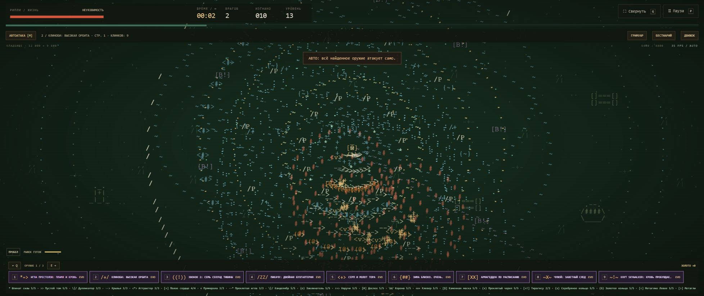

Пассивки: Гематоген из девственниц, Методичка по скорострельности, Дубликатор, Лесные спиды, Пылесос душ, Допельхертц, Капельница, Шило навылет, Люстра Судного дня, Синяя изолента, Ускоритель частиц с AliExpress, Доспех, Красный диплом, Карманный рандом, Кэшбек святого Петра, Череп марлина, Квитанция из загробного мира, Минутная стрелка, Часовая стрелка, Полис «Жизнь» и Правое, Капитал. Кольца и Метаглио имеют 5 ступеней и нужны для специальных эволюций. Полезные и проклятые бонусы предметов работают и до эволюции.

Поле стало зеленее, а Джек-о-Лантерн и его огненные шары получили собственный оранжевый цвет. Надгробия, валуны, сухие деревья, склепы и обломки стен — твёрдые препятствия: герой и враги упираются в них, рывок не проходит насквозь. Между участками остаются проходы, стартовая площадка свободна. Трава и мелкие отметки на земле остаются декоративными.

Общий множитель кулдауна оружия — **0,85**: интервалы на 31% длиннее прошлой версии (0,65), в ручном и автоматическом режимах. Ранги оружия ускоряют стрельбу на 5% за ступень вместо 12%. Пассивки дают линейные +10% урона и +8% частоты за ранг. Базовый кулдаун рывка сохраняет множитель 0,6; бонус от Лесных спидов теперь умереннее.

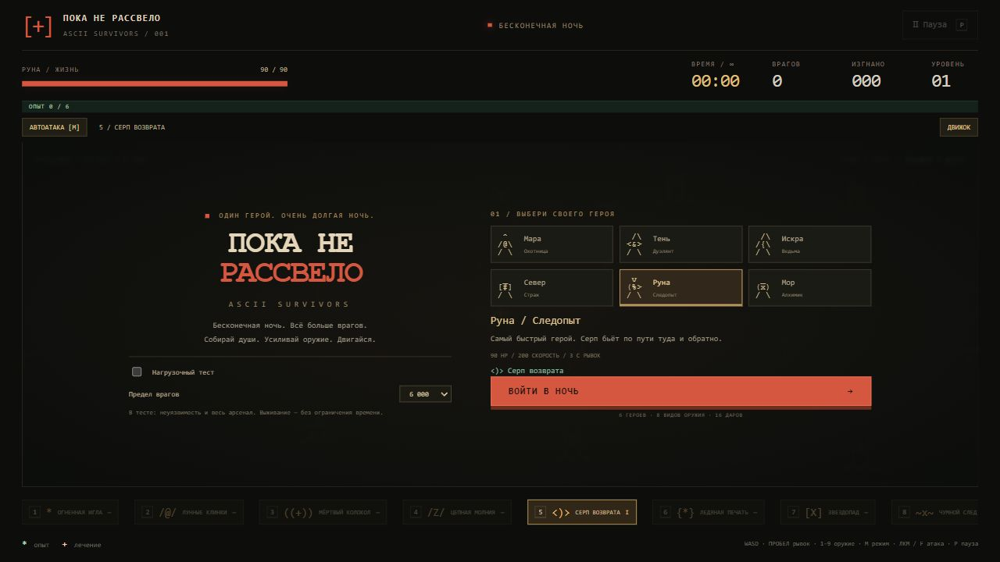

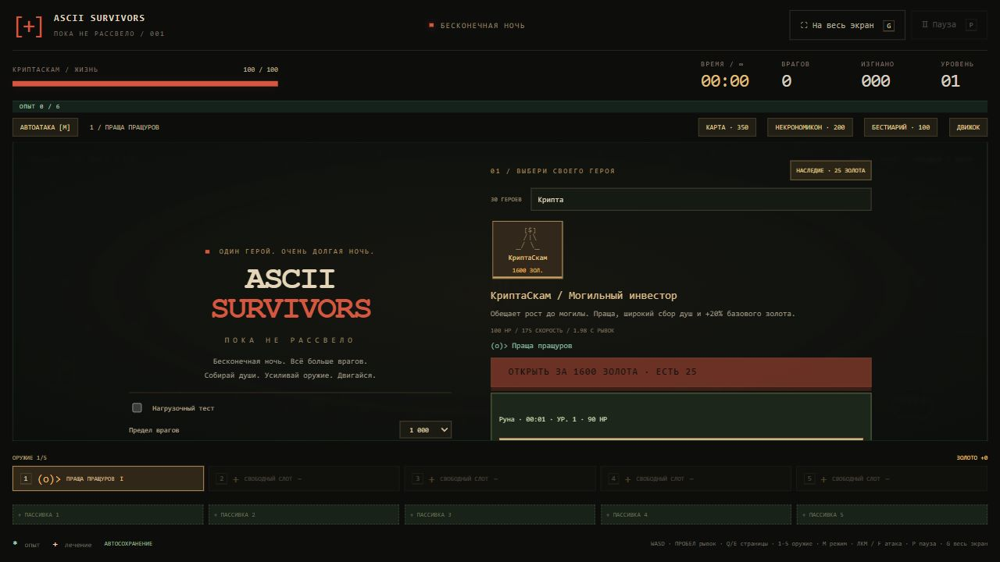

## Дубликатор, эволюции и Некрономикон

**Дубликатор** теперь даёт +1 вращающийся клинок, книгу, снаряд или удар совместимого оружия за ступень: один клинок становится двумя. Это добавление количества, а не умножение всего арсенала на два при каждом ранге. В ручном режиме клинки получают дополнительные взмахи. Количество работает также для игл, серпов, молний, метеоров, воды и птиц; ауры, защитные заряды, пентаграмма и луч ланцета не размножаются.

Добавлены три оружия с четырьмя рангами: **Арбалет Ван Дер Хельсинга** — пробивающие болты; **Гаусс Полураспад** — редкие мощные разряды сквозь длинный ряд целей; **Плазменный миниган Маркус** — частая зелёная плазма с небольшими взрывами. Пистоль, Джеймс Пистоль уже есть и не дублируется. Новое оружие доступно в предложениях уровня, наградах сундуков и разделе оружия Некрономикона, занимает обычные пять слотов и поддерживает Дубликатор, пробитие, силу, скорость снарядов, область и длительность. У новых трёх оружий пока нет эволюций. Скорость минигана — от 0,153 с между залпами до бонусов частоты; предел всех летающих реликвий остаётся 512.

Есть **31 эволюция для 33 базовых оружий**, включая два объединения. Названия оружия и эволюций — каламбуры с отсылками к фантастике, кино и играм. Тип базового оружия доступен в подсказке слота. Кнопка **«Некрономикон»** открывает все рецепты, текущие ранги ингредиентов и уже полученные эволюции; бой на это время останавливается.

Правило адаптировано из [Evolution — Vampire Survivors Wiki](https://vampire.survivors.wiki/w/Evolution): прокачайте оружие до нашего максимума **4/4**, возьмите указанную пассивку и откройте подходящий сундук. Обычные катализаторы достаточно иметь на первой ступени. Для ланцета и лавра нужны обе соответствующие пассивки на максимуме **5/5**. Постоянные улучшения «Наследия» не заменяют предметы забега. Пассивки после эволюции остаются. Эволюция заменяет базовое оружие в его слоте, управление не меняется.

Сундук подходит, если его босс появился **начиная с 10:00**, либо это мегабосс. Ранний сундук не становится эволюционным от ожидания. Каждый сундук предлагает **три варианта с выбором одного**, включая сундуки мегабоссов. Готовые эволюции попадают в варианты первыми. До выбора усиления не применяются; повышение оружия до максимума не превращает его сразу в эволюцию.

| Оружие (тип) | Катализатор | Эволюция |
| --- | --- | --- |
| Поджигатор 3000 (Огненная игла) | Методичка по скорострельности 1+ | Поджигатор 3000: пламя и кровь |
| Кольца мясорубки (Лунные клинки) | Дубликатор 1+ | Клиноби: высокая орбита |
| Стигийский мегафон (Мёртвый колокол) | Череп марлина 1+ | Звонок 2: семь секунд тишины |
| Карманная катушка Теслы (Цепная молния) | Дубликатор 1+ | Пикачу: двойная бухгалтерия |
| Серп + Молот Бора (оба 4/4) | Капитал 1+ | Миколенин |
| Сигил Деда Мороза (Ледяная печать) | Синяя изолента 1+ | Зима близко. Очень. |
| Метеоритный дождь (Звездопад) | Люстра Судного дня 1+ | Армагеддон по расписанию |
| Язва Чужого (Чумной след) | Кэшбек святого Петра 1+ | Чужой: заветный след |
| Кнут Новой надежды (Кнут) | Допельхертц 1+ | Кнут Новой надежды: кровь пробуждается |
| Топорики Т-77 (Топор) | Люстра Судного дня 1+ | Топор: игра окончена |
| Крещёная минералка (Святая вода) | Пылесос душ 1+ | Лужа справедливости |
| Скандинавский пинбол (Рунный след) | Доспех 1+ | Скандинавский пинбол: будущего нет |
| Игрушечный пентакль (Пентаграмма) | Красный диплом 1+ | Луна, дай XP! |
| Кадило на цепи (Чеснок) | Капельница 1+ | Ганнибал Лектор: на гарнир |
| Ножи 47-й аргумент (Ножи) | Ускоритель частиц с AliExpress 1+ | Тысяча причин для Матрицы |
| Фаерболл Балрога (Огненный жезл) | Гематоген из девственниц 1+ | Балрог: проходите, не задерживайтесь |
| Луч Доктора Что? (Часовой ланцет) | Минутная стрелка МАКС. + Часовая стрелка МАКС. | Доктор Кто: коридор бесконечности |
| Божья страховка (Лавр) | Полис «Жизнь» МАКС. + Полис «Франшиза» МАКС. | Алый плащ Доктора Стрэнджа |
| Библия Джона Кика (Королевская Библия) | Синяя изолента 1+ | Святые угодники Джона Вика |
| Летучая мышь из Китая (Белая птица) | Лапки бэтмена МАКС. | Голубь мира: перезагрузка |
| Пистоль, Джеймс Пистоль | Карманный рандом 1+ | Лицензия на крит |
| Праща пращуров | Гематоген из девственниц 1+ | Давид и Голиаф: реванш |

**Миколенин** заменяет Серп и Молот Бора красной аурой: базовый радиус 230, урон 86,7 за срабатывание против радиуса 135 и урона 17 у максимального кадила. Книга «Капитал» остаётся и даёт +15% золота за ранг, до +75%. Прежняя эволюция «Серп и молот Тора» переносится в Миколенина с первым рангом книги.

**Пистоль, Джеймс Пистоль** выпускает быстрые пули. «Лицензия на крит» удваивает частоту огня и добавляет тройные критические попадания. **Праща пращуров** отталкивает камнями; эволюция взрывает их при попадании и удваивает прямой урон по боссам. Дубликатор добавляет пули, камни и удары Молота.

Эффекты меняются вместе с названием: косы летят радиально, святая вода растёт и движется к герою, руны взрываются при рикошете, молния получает отложенный повторный удар, книги вращаются постоянно в автоматическом режиме. Критические удары кнута лечат, чесночная аура поглощает здоровье, плащ ограничивает входящий удар до 10 перед бронёй, коридор раз в полный оборот луча уменьшает здоровье обычных врагов вдвое. Урон коридора по боссам ограничен.

Белый «Летучая мышь из Китая» и чёрный «Лапки бэтмена» прокачиваются отдельно. Максимум обеих птиц даёт объединение без пассивки: основной слот превращается в «Голубя мира: перезагрузка», второй помечается как поглощённый и перестаёт выпадать в улучшениях. В старых сохранениях прежняя пара птиц переносится в два отдельных оружия того же ранга.

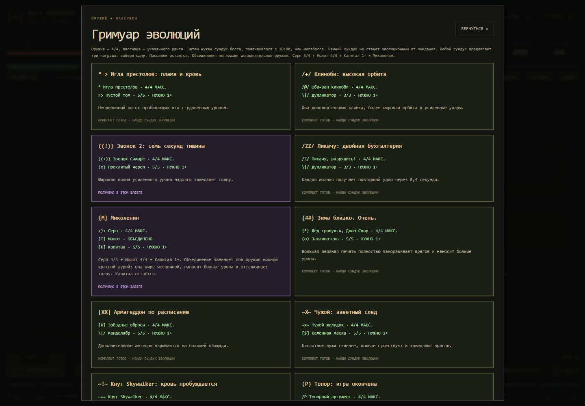

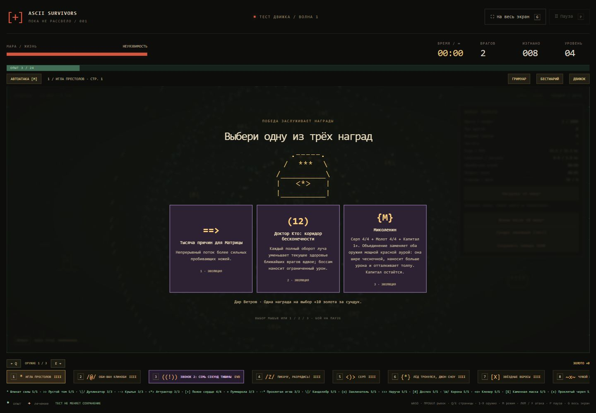

## Наследие: постоянный прогресс

Кнопка **«Наследие · … золота»** над выбором героев открывает магазин. Начальный запас — 50 золота; статистика старого профиля также превращается в стартовый бонус. Ставка заработка уменьшена ещё на 40% относительно предыдущей версии: 0,45 золота за каждые 5 убийств, 2,25 за активную минуту, 11,25 за мини-босса, 56,25 за мегабосса и 4,5 за выбранную награду сундука. Дроби накапливаются; старый кошелёк не уменьшается. Кэшбек святого Петра и Череп марлина увеличивают заработок.

Героев можно просматривать до покупки; поиск фильтрует по имени и роли. **Клык доступен сразу**, остальные открываются за золото профиля по ценам из таблицы. Переименование сохраняет прежние ID, характеристики, цены и покупки: Мара → Клык, Искра → Катод, Север → Вектор-6, Рипли → Тлен, Шепард → Сигма, Сэмус → Болт, Мандалорец → Шрам. Руна, Мор и Тень сохраняют имена. В нагрузочном тесте можно попробовать любого героя; это не покупает его и не расходует золото.

Восемь постоянных улучшений дают здоровье, урон, частоту атак, движение, броню, притяжение опыта, рост опыта и дополнительные жизни. Цена ранга растёт квадратично: базовая стоимость × (следующий ранг)². Первые семь улучшений имеют 5 рангов, возрождение — 2. Покупка применяется **к новым забегам**; продолжение сохранённого забега использует его прежние постоянные параметры.

Золото попадает в профиль при автосохранениях и завершении попытки. Повторное сохранение или продолжение той же попытки не начисляет уже полученное золото заново. Настройки из другой вкладки сохраняют сделанные покупки. Нагрузочный тест не зарабатывает золото.

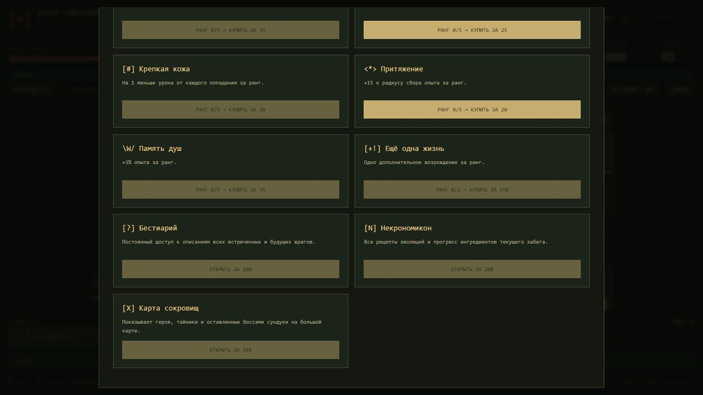

## Противники и боссы

К зомби, мышам, скелетам и громилам присоединились мумии, могильные пауки, Джек-о-Лантерн, личи, вампиры, оборотни и Чужие. Новые виды постепенно входят в волны. Мумия замедляет при попадании, личи держат дистанцию и стреляют проклятиями, тыквы бросают веер огненных шаров, оборотни и ксеноморфы атакуют рывком.

Боссы чередуются в таком порядке:

| Босс | Особенность |
| --- | --- |
| Лич-лорд | Проклятия и призыв скелетов |
| Зомби-лорд Бритиш | Поднимает зомби и мумий |
| Фредди Крюгер | Телепортация к отмеченной точке рядом с героем |
| Джейсон Вурхиз | Тяжёлый рывок с предварительным предупреждением |
| Матка Чужих | Рывки и призыв ксеноморфов |
| Жнец | Постоянное преследование |

Перед рывком видна линия атаки, перед телепортацией — метка назначения, включая случаи, когда сам Фредди за экраном. Шанс аптечки снижен вдвое: с обычного врага — 1,75% до удачи, с босса — 50% вместо гарантированного выпадения. Лечение по-прежнему восстанавливает 20 HP или 60 HP соответственно. Призывы учитывают общий предел врагов; одновременно существует не больше 256 вражеских снарядов.

Кнопка **«Бестиарий»** открывает ASCII-портреты и описание каждого противника. Бой при просмотре останавливается.

### Мегабосс Дар Ветров

Начиная с **10-й минуты**, когда нет другого живого босса или встречи с печатью, появляется чёрный леший **Дар Ветров**. Следующее окно мегабосса — на следующем кратном 10 минутам рубеже. Его встреча проходит **без замыкающей стены**.

Перед атакой три красные пунктирные линии на 1,6 секунды показывают направление. Затем три кнута длиной 4 800 игровых единиц бьют через половину короткой стороны мира, а два кольца выпускают **40 красных сфер** с разной скоростью. Направление кнутов фиксируется при предупреждении: нужно уйти с линии. Начальное здоровье — 16 200; оно растёт в последующих встречах. После победы остаётся сундук **с выбором одной из трёх наград** и начисляется 56,25 золота до бонусов.

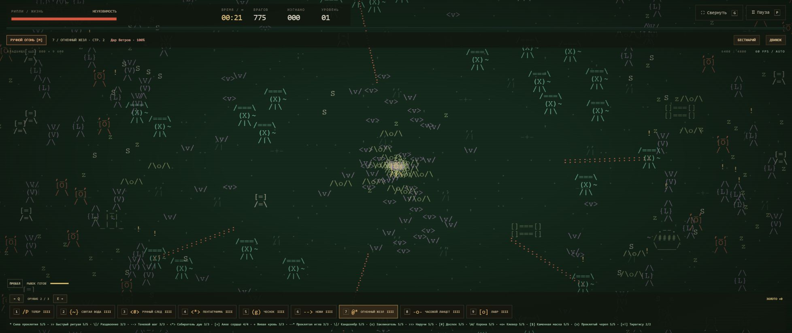

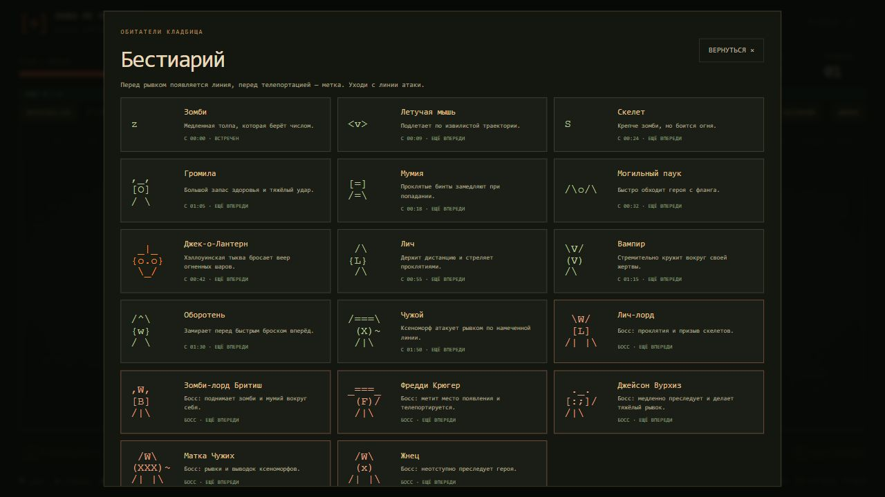

## Стена, усиленные мини-боссы и сундуки

Перед встречей появляется **пятисекундное предупреждение** и контур печати. Затем вокруг героя замыкается непроходимая стена **максимум на 15 секунд**. Смерть мини-босса снимает её немедленно; оставшееся время видно на экране. Если таймер истёк раньше победы, босс остаётся на поле — можно отойти и добить его позже. Следующая печать не появляется, пока он жив. Камера удерживает площадку в кадре. После снятия стены герой получает 1,5 секунды неуязвимости, чтобы успеть уйти от толпы.

В печати первый босс получает 1 500 базовых HP, второй — 3 200, каждый следующий — ещё +1 000. К каждому добавляется +200 HP за каждый уровень героя выше первого на момент появления. Множители роста HP со временем внутри печати не применяются. Стена исчезает через 15 секунд независимо от оставшегося HP босса или сразу после его убийства. Его урон снижен на 25%, внутри печати могут одновременно находиться максимум четыре призванных помощника. Автоатака выбирает босса в приоритет и не отвлекается на врагов за стеной. Внутри печати препятствия временно исчезают, обычная толпа и её входящие снаряды остаются снаружи; рывок не проходит через стену.

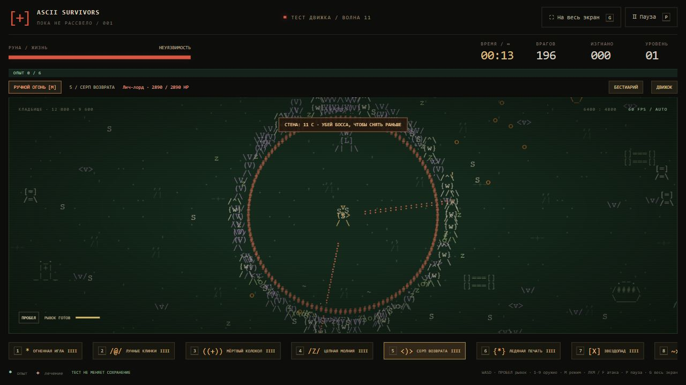

Побеждённый босс оставляет сундук. Подойдите к нему: **три карточки, одна награда на выбор**. В подходящем сундуке сначала предлагаются готовые эволюции, затем улучшения найденных предметов или новое оружие. Когда всё максимально, варианты заменяются золотом, опытом и тремя защитными зарядами на 30 секунд. Дополнительно за выбор начисляется 7,5 базового золота с учётом бонусов; автоматического лечения и опыта нет.

Бой при открытии остановлен. Выберите карточку мышью или клавишами **1 / 2 / 3**. Перезагрузка сохраняет те же три варианта без начисления наград; повторный выбор невозможен. Старые сохранения с уже начисленным сундуком показывают прежнюю кнопку «Забрать», не выдавая награды повторно.


## Сохранение прогресса

Обычный забег автоматически записывается в `localStorage` каждые 10 активных секунд, при паузе, выборе улучшения, уходе со страницы и скрытии вкладки. Сохраняются герой, позиция, здоровье, оружие и его ступени, опыт, время, враги, снаряды, призывы в процессе подготовки и предметы на поле. Незавершённый выбор дара восстанавливается с теми же вариантами. Зажатые кнопки ввода сбрасываются.

На стартовом экране появляется **«Продолжить забег»** с именем героя, временем, уровнем и здоровьем. Игра ждёт нажатия этой кнопки. **«Новый забег»** заменяет старое сохранение; кнопка смены героя позволяет вернуться к выбору, сохранив текущую попытку для продолжения. Формат снимка обновлён до версии **7** с поддержкой старых снимков версий 1–6. Сохраняются полученные эволюции, объединённые слоты, пригодность сундуков для эволюций, отложенные повторные атаки, новое оружие, заморозка, защитные заряды, использованные возрождения, параметры наследия, заработок, расписание мегабоссов, замкнутая стена с оставшимся временем, здоровье её босса, оставленные сундуки и ещё не выбранные варианты открытого сундука. Старые уже начисленные награды закрываются без повторной выдачи. В старом сохранении внутри печати босс получает новый баланс с сохранением доли оставшегося здоровья, стене назначается предел 15 секунд.

Также сохраняются настройки героя, режима стрельбы и предела врагов, рекорд, число законченных или прерванных новым стартом забегов, суммарные убийства, побеждённые боссы и встреченные виды монстров. Старый рекорд и выбранный герой из предыдущей версии переносятся. Нагрузочный тест не перезаписывает обычный забег и не увеличивает статистику.

Сохранение привязано к браузеру и адресу сайта: localhost и GitHub Pages хранят разные данные. Очистка данных сайта удаляет прогресс. Если браузер запретил запись или закончилось место, появляется сообщение; игра продолжает работать, последний успешно записанный checkpoint остаётся. Повреждённые и неподдерживаемые сохранения не запускаются.

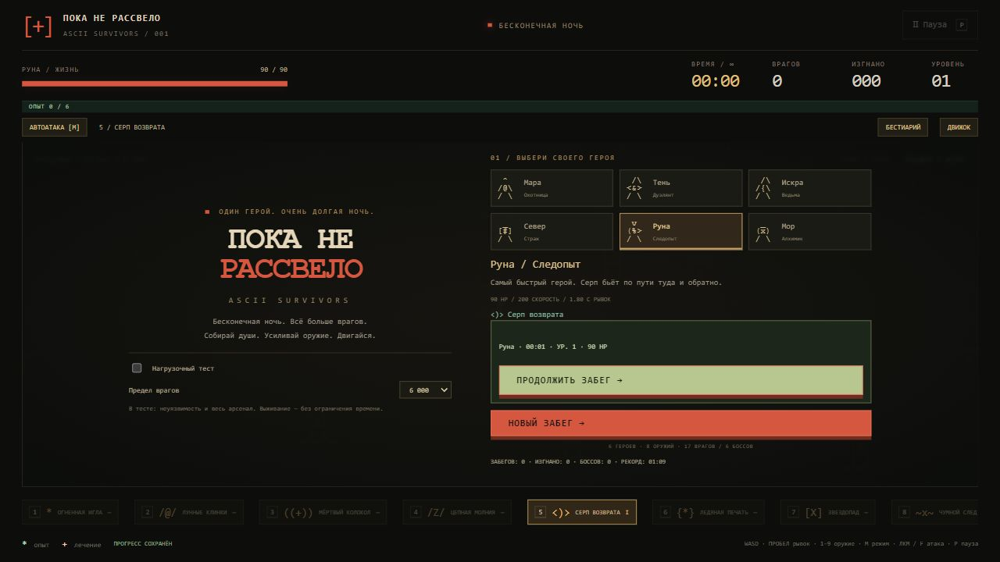

## Проверка нагрузки

Перед стартом включите **«Нагрузочный тест»**: герой становится неуязвимым, весь арсенал и пассивные дары сразу максимально улучшены, рекорд выживания не меняется. Обычная арена сохраняет здоровье и постепенное получение оружия.

Выберите предел одновременно живых врагов: 1 000 / 3 000 / 6 000 / 12 000 / 24 000. По умолчанию 6 000. Достигнув предела, игра ждёт свободных мест; враги не исчезают для поддержания FPS. Расталкивание толпы проверяет ограниченное число соседей, чтобы не делать попарный перебор всей толпы.

Когда на поле больше тысячи врагов, совпадающие позиции в одной ASCII-клетке отрисовываются одним представителем. Все враги остаются отдельными объектами симуляции и получают урон. «Видимые группы» показывает число отрисованных представителей в кадре; боссы рисуются отдельно. Это сокращает повторную отрисовку плотной толпы.

Кнопка **«Движок»** показывает текущее и максимальное число врагов, FPS, средний интервал кадра и P95 за последние 180 кадров, затраты симуляции и отрисовки, снаряды и дроп. Интервал кадра включает ожидание следующего обновления экрана; затраты симуляции/отрисовки показывают работу JavaScript и отправку команд Canvas, а не отдельное время GPU.

Время забега считает активные секунды. «Обработано игрой» показывает время физических шагов. При сильном падении FPS оно может отставать: догоняющая симуляция ограничена 100 мс на кадр. Возраст волн опирается на активное время и продолжает увеличивать сложность.

**«Нагрузка +5 минут»** усиливает волны до соответствующего возраста, не прибавляя фиктивное время к забегу. Шесть нажатий позволяют быстро проверить волны как после получаса. **«Сохранить замеры JSON»** выгружает параметры и последние 3600 секунд замеров. В паузе замеры не накапливаются. Проверять частоту следует в видимой вкладке: фоновые вкладки браузер может замедлять.

**«Сундук эволюций (тест)»** показывает пробный сундук с выбором одной из трёх готовых эволюций. Кнопка доступна только в нагрузочном режиме; обычный прогресс и золото она не меняет.

Кнопка **«Волны после 10 минут»** в нагрузочном тесте сразу открывает возраст появления мегабосса. Нажмите её в начале попытки, пока нет другого босса, чтобы проверить Дара Ветров без ожидания десяти минут.

## Реализация и проверки

`combat.js` — фактический урон каждого оружия, overkill, лечение, награды и сохраняемые срезы боя по 10 секунд. `data/enemies.json` — новые враги; `node build-enemies.cjs` обновляет браузерный каталог `enemy-roster.js`. `enemy-system.js` — реестр движения и директор волн. `catalog.js` — отдельный реестр героев, врагов, оружия, пассивок и постоянных улучшений. `core.js` — независимая симуляция, поведение врагов, воспроизводимый генератор и пространственная сетка. `progress.js` — версионированные снимки забега, миграция, статистика, кошелёк и магазин. `renderer.js` — ASCII-атлас, ограниченный кеш декораций и интерполяция. `game.js` — ввод, интерфейс, автосохранение, метрики и обновление по частоте экрана без лимита 30 FPS. Физика работает с фиксированным шагом 1/60 секунды. Системная настройка уменьшения движения убирает вспышку при уроне.

- `node verify.cjs` проверяет бой, ручной/автоматический режим, слоты, получение оружия, героев, бесконечное время, слияние опыта и кеш отрисовки.
- `node verify-sandbox.cjs` проверяет всех героев, оружие и эволюции в песочнице, 58 целей, повторяемость характеристик, сохранность кошелька/забега, разные силуэты и выбор наград.
- `node verify-forest.cjs` проверяет обе арены, проходимость дорог, коллизии деревьев, 30 составов волн, бесконечное продолжение и сохранение карты.
- `node verify-reroll.cjs` проверяет доступность всех 33 оружий, приоритет двух оружий и одной пассивки, полный платный реролл, рост цены, учёт кошелька, старые сохранения и восстановление после ошибки записи.
- `node verify-supplies.cjs` проверяет 48 случайно расположенных ящиков на обеих картах: лечение, бесплатный уровень, сбор всех кристаллов, одноразовую выдачу, сохранение и изоляцию тестовых режимов.
- `node verify-enemies.cjs` проверяет 18 видов врагов, предупреждения атак, поведение мини-боссов и пределы призывов/снарядов.
- `node verify-progress.cjs` проверяет JSON round trip, восстановление Set/Map, незавершённые улучшения, миграцию, статистику, ошибки хранилища и изоляцию нагрузочного теста.
- `node verify-arena.cjs` проверяет коллизии и рывок, обход препятствий, таймер печати, условие снятия стены, сундуки, однократную выдачу награды и совместимость снимков.
- `node verify-content.cjs` проверяет 13 дополнительных механик оружия, пассивки, страницы, новых героев, покупки и накопление золота без повторного начисления, ошибки записи, старые снимки и мегабосса после 10-й минуты.
- `node verify-evolution.cjs` проверяет дополнительные клинки и книги, 31 рецепт, ранги катализаторов, возраст сундука, награды мегабосса, объединение птиц, миграцию и боевые эффекты эволюций.
- `node benchmark.cjs` измеряет 120 шагов после прогрева для смешанных толп из всех 11 обычных видов численностью 1 000–24 000 и проверяет 30 минут **ускоренной симуляции** с шагом 50 мс и пределом 1 000 врагов. Результат записывается в `benchmark-results.json`.
- Эти измерения Node **не включают отрисовку и GPU** и не заменяют получасовой браузерный тест. Реальную частоту на конкретном устройстве показывает панель в игре.

Вариант дальнейшего сетевого кооператива разобран в [COOP_PLAN.md](COOP_PLAN.md). Сетевой режим в текущей сборке ещё не реализован.

`node verify-progression.cjs` проверяет объединение в Миколенина, старые сохранения, выбор одной награды без повторного начисления, пистоль и пращу, снижение аптечек, рост волн и покупки героев с сохранением кошелька.

## Разделы, тайники и новый ростер

Через «Наследие» навсегда открываются **Бестиарий — 100**, **Некрономикон — 200**, **Карта сокровищ — 350** золота. Покупки доступны между забегами и сохраняются в профиле. В нагрузочном тесте разделы можно просматривать без покупки.

Карта отмечает героя (`@`), 12 настоящих тайников (`X`) и оставленные сундуки (`$`). Подойдите к тайнику на поле: бой остановится и появится обычный выбор одной награды из трёх. Тайник открывается один раз за забег; его состояние и открытая награда сохраняются. Тайники можно случайно найти и без купленной карты.

Кроме тайников на обеих аренах есть **48 ящиков припасов**. Расположение и содержимое меняются с началом нового забега; ящики распределены по карте вне препятствий. Один ящик есть примерно в 540 единицах от старта, остальные требуют исследования. Подойди к ящику, чтобы открыть его: `[+]` лечит до 30 HP, `[^]` даёт ровно один бесплатный уровень с обычным выбором улучшения, `[U]` собирает все уже лежащие на карте кристаллы с обычным множителем опыта. Начисленный опыт и открытые ящики сохраняются; повторной выдачи после загрузки нет. В песочнице и нагрузочном тесте ящиков нет. Купленная карта показывает все неоткрытые припасы.

Реролл на уровне стоит 5 → 10 → 15… **только из заработанного в этом забеге золота за вычетом предыдущих рероллов**. Старые накопления «Наследия» не оплачивают рероллы. В кошелёк остаётся чистый доход; повторные сохранения не возвращают потраченное золото.

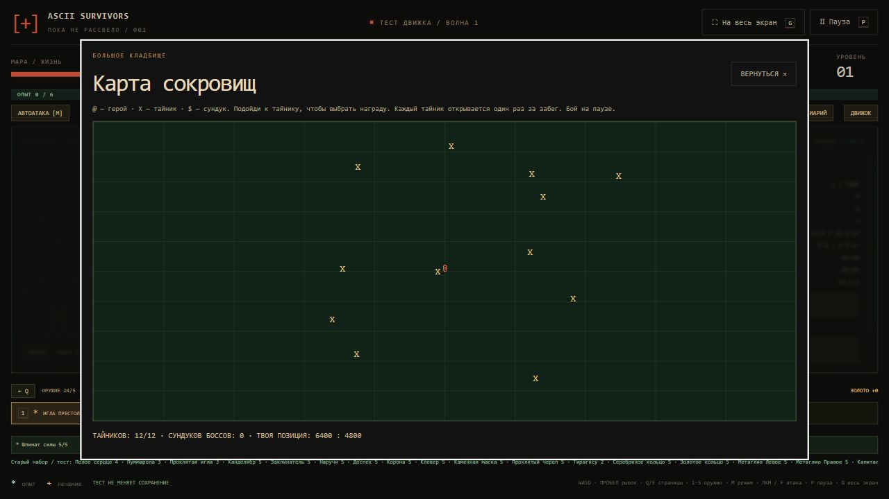

Из переданного ростера добавлены 29 обычных видов, 6 боссов и 5 элит. Новые движения: проход по прямой, синусоидальное приближение, рывок с предупреждением и восстановлением, орбита вокруг героя. Сопротивление отбрасыванию отличает тяжёлых врагов; Мать Бледность призывает крыс. Новые боссы получают окна с 05:00 (Звонарь), 10:00 (Мать Бледность), 15:00 (Процессия), 20:00 (Кардинал Ноль), 25:00 (Святой без кожи), 30:00 (Администратор). Живой босс откладывает следующую встречу. Дар Ветров и прежние противники сохраняются.

Администратор не завершает забег автоматически: его можно победить и продолжить бесконечное выживание. Условные значения HP и скорости из документа адаптированы к единицам нашей игры.

Оценка архитектуры, принятые решения и отложенные пункты: [ENEMY_SYSTEM_ASSESSMENT.md](docs/ENEMY_SYSTEM_ASSESSMENT.md). Отдельные классы под каждого врага не создаются. JSON — источник новых определений; браузерный JS генерируется заранее, чтобы игра работала и из локального файла.

`node verify-director.cjs` проверяет 5+5, допустимые предложения уровня и сундука, освобождение слота после объединения, миграцию старых наборов, все новые определения и движения, расписание боссов, плотность волн, тайники, снижение золота и постоянные покупки разделов. `node build-enemies.cjs --check` проверяет, что браузерный каталог соответствует JSON.

`node verify-heroes.cjs` проверяет ростер из 30 героев, стартовый бой каждого, ASCII-портреты, продолжение сохранений с прежними ID, сохранность покупок, новые открытия и бонус золота КриптаСкама.


## Расписание волн и разбор боя

Герои, оружие, пассивки, рецепты и враги теперь редактируются в [`data/`](data/README.md). У каждого есть единое поле `description` для шуток и полезных подсказок. Некрономикон содержит отдельные страницы оружия и пассивок. В GitHub Actions каталоги автоматически собираются из JSON; локально используются `node build-content.cjs` и `node build-enemies.cjs`. `catalog.js` только соединяет данные и сохраняет прежние ID, порядок и характеристики. `node verify-data.cjs` проверяет поля, ссылки, генерацию, браузерную загрузку и старые сохранения; всего в Actions 11 наборов проверок.

В панели **«Движок»** доступны урон и доля каждого оружия, DPS, лишний урон, лечение и потери HP, опыт, золото и аптечки. Срезы идут по 10 секунд и сохраняются вместе с забегом. Кнопка **«Сохранить замеры JSON»** выгружает параметры билда и историю локально. Старые сохранения продолжаются; измерения для них начинаются с загрузки. Пассивки и награды в этом обновлении не изменены.

Расписание, квоты и точное значение показателей: [WAVE_DIRECTOR.md](docs/WAVE_DIRECTOR.md). Разбор независимого JS-референса: [SURVIVORS_REFERENCE_STUDY.md](docs/SURVIVORS_REFERENCE_STUDY.md).

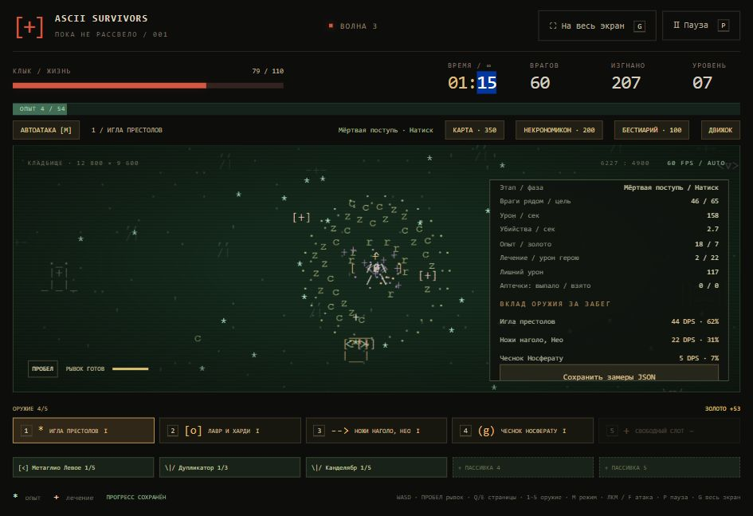

`node verify-combat.cjs` проверяет все 24 источника оружия, фактический урон и overkill, лечение, награды, сохраняемые срезы, старые снимки, квоты и передышки. В Actions выполняются все десять наборов проверок.

`node verify-scifi.cjs` проверяет три новых оружия, прицеливание, режимы огня, пробитие, взрывы, Дубликатор, награды, предел снарядов и миграцию старых забегов. Снимок забега версии 10; версии 1–9 продолжают загружаться без потери рангов, золота и покупок.

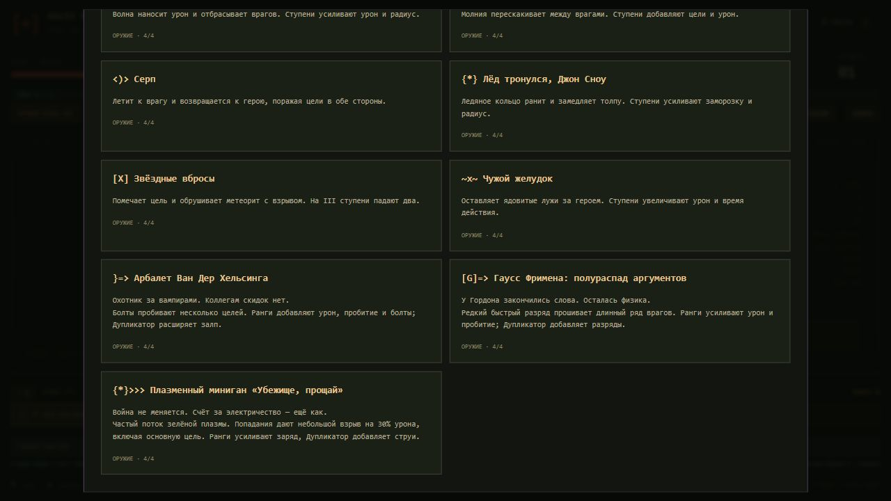

## Правки из авторских таблиц

Новые названия, описания, стартовые наборы и визуальные пожелания перенесены из двух авторских таблиц. Герои смотрят по последнему направлению движения в четырёх направлениях и сохраняют взгляд на паузе и после остановки. Ручной прицел не поворачивает героя против движения. [Подробности и совместимость](docs/SHEET_CHANGES.md).
