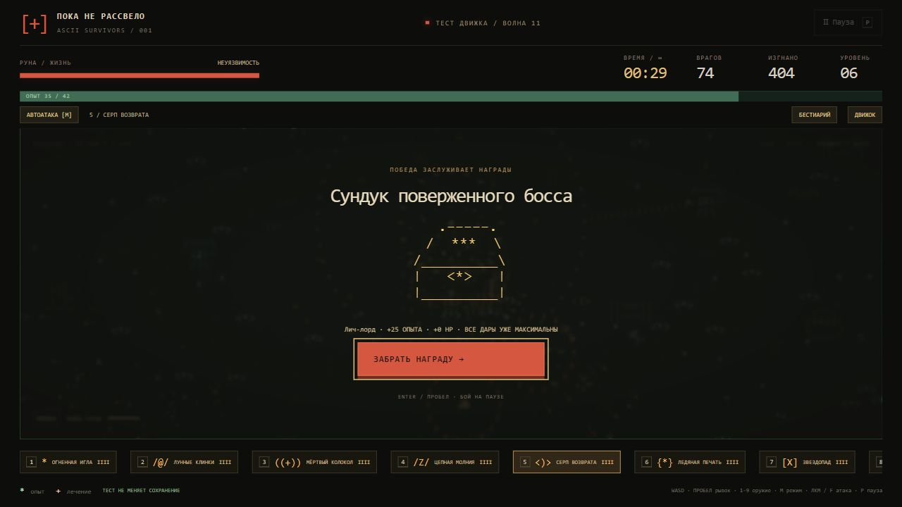

# ASCII Survivors · Пока не рассвело

[](https://github.com/toxic8yte/ascii-survivors/actions/workflows/pages.yml)

Бесконечная браузерная арена на JavaScript и Canvas: шесть героев, восемь видов оружия и толпы нечисти, нарисованные ASCII-символами. Работает без сборки, библиотек и внешних ресурсов. Управление с клавиатуры, мыши и сенсорного экрана.

**[Играть в браузере →](https://toxic8yte.github.io/ascii-survivors/)**


## Запуск

Скачайте репозиторий через **Code → Download ZIP**, распакуйте архив и откройте `index.html` в браузере.

Либо запустите локальный сервер из папки проекта, если установлен Python:

```sh
git clone https://github.com/toxic8yte/ascii-survivors.git
cd ascii-survivors
python -m http.server 4173
```

Откройте <http://127.0.0.1:4173/>. Node.js нужен только для проверок и измерений; самой игре он не требуется.

## GitHub Actions и публикация

Workflow [Test and deploy game](.github/workflows/pages.yml) запускается при push в `main`, при pull request в `main` и вручную через **Actions → Test and deploy game → Run workflow**. Сначала проверяется синтаксис JavaScript и выполняется `node verify.cjs`; после успешных проверок `main` публикуется в GitHub Pages. Pull request запускает только проверки.

В **Settings → Pages → Build and deployment → Source** выбран **GitHub Actions**. Для копии репозитория нужно включить тот же источник публикации. Порядок настройки описан в [документации GitHub](https://docs.github.com/en/pages/getting-started-with-github-pages/using-custom-workflows-with-github-pages).

В артефакт сайта попадают только `index.html`, `style.css`, `core.js`, `progress.js`, `renderer.js` и `game.js`. Браузер выполняет игру на устройстве игрока; Actions проверяет файлы и публикует статический сайт. Сервер сетевого кооператива в этой версии отсутствует.

При упаковке к адресам CSS и JavaScript добавляется SHA коммита. После обновления страницы браузер получает ресурсы той же версии, что и HTML, вместо старых файлов из кеша. Локальный запуск не требует упаковки.

## Что есть в игре

Время забега не ограничено. Волны, число появляющихся врагов, их здоровье и урон растут. Через минуту возраста волн начинается первое предупреждение о мини-боссе. После победы до следующего события проходит 90 секунд; шесть боссов чередуются по кругу.

Размер мира — **12 800 × 9 600** игровых единиц: по каждой стороне в четыре раза больше исходной карты, по площади — в 16 раз. Герой начинает в центре, декорации создаются только рядом с камерой, кеш ограничен 36 участками. Звёздочки опыта и аптечки используют отдельные светлые цвета и рисуются поверх боевых эффектов.

Зелёные `*` дают опыт, красные `[+]` лечат. Уровень останавливает бой и предлагает три дара. Первый выбор всегда содержит новое оружие. Близкие осколки объединяются с сохранением всего опыта; лечение остаётся на поле до двух минут, одновременно хранится до 128 аптечек.

## Управление

- WASD / стрелки — движение; пробел — рывок.
- **M** или кнопка режима — автоматические атаки / ручное управление.
- В авто-режиме работает **всё найденное оружие**.
- В ручном режиме **1–9** выбирают слот, **ЛКМ или F удерживаются для атаки**. Курсор задаёт прицел; без курсора атака идёт по последнему направлению движения.
- 1 игла, 2 клинки, 3 колокол, 4 молния, 5 серп, 6 лёд, 7 метеорит, 8 яд, 9 пока пуст. Ненайденное оружие не выдаётся нажатием цифры.
- На экране улучшений 1 / 2 / 3 по-прежнему выбирают дар.
- **G** или «На весь экран» — развернуть игровое поле; повторное G, «Свернуть» или Escape возвращает обычный вид.
- P — пауза; Escape в обычном виде тоже ставит игру на паузу. R — новый забег. Героя можно сменить перед стартом, из паузы и после поражения.
- На телефоне: джойстик, рывок, кнопка атаки в ручном режиме; касание поля задаёт прицел. Слоты оружия нажимаются и прокручиваются горизонтально.

В ручном режиме игла и серп летят к прицелу, молния выбирает первую цель в направлении прицела, метеорит и яд ставятся в выбранную точку в пределах дальности. Колокол и лёд действуют вокруг героя, клинки делают направленный взмах. Перезарядки сохраняются при смене режима и оружия.

Страница использует всю ширину окна без ограничения 1500 px. В развёрнутом виде Canvas занимает всю область просмотра, а здоровье, таймер, кнопки и оружие размещены поверх поля. Размер рисунка пересчитывается автоматически. Если браузер разрешает Fullscreen API, скрывается и интерфейс браузера; в остальных случаях поле заполняет окно вкладки. Разворачивание доступно до старта и во время игры, не заменяет сохранённый забег.


## Герои и арсенал

| Герой | Начальное оружие | Особенность |
| --- | --- | --- |
| Мара, охотница | Огненная игла | Сбалансированные параметры |
| Тень, дуэлянт | Лунный клинок | Рывок каждые 1,56 секунды |
| Искра, ведьма | Цепная молния | Атака нескольких целей |
| Север, страж | Ледяная печать | 150 здоровья, замедление врагов |
| Руна, следопыт | Серп возврата | Самый быстрый бег |
| Мор, алхимик | Чумной след | Большой радиус сбора опыта |

Всего 8 видов оружия с четырьмя ступенями, 16 даров и 17 видов врагов, включая 6 боссов. Пассивные дары усиливают урон, частоту атак, снаряды, движение и выживаемость. Скрытая вкладка автоматически ставит игру на паузу.

Поле стало зеленее, а Джек-о-Лантерн и его огненные шары получили собственный оранжевый цвет. Надгробия, валуны, сухие деревья, склепы и обломки стен — твёрдые препятствия: герой и враги упираются в них, рывок не проходит насквозь. Между участками остаются проходы, стартовая площадка свободна. Трава и мелкие отметки на земле остаются декоративными.

Кулдауны оружия уменьшены на **35%** в ручном и автоматическом режиме; орбитальные клинки тоже вращаются быстрее. Кулдаун рывка уменьшен на **40%**: у Мары 2,04 секунды вместо 3,4. Дары скорости дополнительно сокращают эти интервалы.


## Противники и боссы

К зомби, мышам, скелетам и громилам присоединились мумии, могильные пауки, Джек-о-Лантерн, личи, вампиры, оборотни и Чужие. Новые виды постепенно входят в волны. Мумия замедляет при попадании, личи держат дистанцию и стреляют проклятиями, тыквы бросают веер огненных шаров, оборотни и ксеноморфы атакуют рывком.

Боссы чередуются в таком порядке:

| Босс | Особенность |
| --- | --- |
| Лич-лорд | Проклятия и призыв скелетов |
| Зомби-лорд Бритиш | Поднимает зомби и мумий |
| Фредди Крюгер | Телепортация к отмеченной точке рядом с героем |
| Джейсон Вурхиз | Тяжёлый рывок с предварительным предупреждением |
| Матка Чужих | Рывки и призыв ксеноморфов |
| Жнец | Постоянное преследование |

Перед рывком видна линия атаки, перед телепортацией — метка назначения, включая случаи, когда сам Фредди за экраном. Боссы оставляют лечение на 60 HP и больше опыта. Призывы учитывают общий предел врагов; одновременно существует не больше 256 вражеских снарядов.

Кнопка **«Бестиарий»** открывает ASCII-портреты и описание каждого противника. Бой при просмотре останавливается.


## Стена, усиленные мини-боссы и сундуки

Перед встречей появляется **пятисекундное предупреждение** и контур печати. Затем вокруг героя замыкается непроходимая стена **максимум на 15 секунд**. Смерть мини-босса снимает её немедленно; оставшееся время видно на экране. Если таймер истёк раньше победы, босс остаётся на поле — можно отойти и добить его позже. Следующая печать не появляется, пока он жив. Камера удерживает площадку в кадре. После снятия стены герой получает 1,5 секунды неуязвимости, чтобы успеть уйти от толпы.

Здоровье мини-босса уменьшено **на 50% относительно первой версии печати**: множитель ×1,25 вместо ×2,5 поверх обычного роста здоровья со временем. Его урон снижен на 25%, внутри печати могут одновременно находиться максимум четыре призванных помощника. Автоатака выбирает босса в приоритет и не отвлекается на врагов за стеной. Внутри печати препятствия временно исчезают, обычная толпа и её входящие снаряды остаются снаружи; рывок не проходит через стену.


Побеждённый босс оставляет сундук. Подойдите к нему, чтобы открыть экран награды: **одно усиление в 70% случаев, три в 25%, пять в 5%**. В первую очередь улучшается уже найденное оружие, затем доступные пассивные дары; если они максимальны — новое оружие. Если все дары уже максимальны, остаются опыт и лечение. Каждый сундук также даёт 25 опыта на число наград и восстанавливает до 35 HP.

Бой при открытии остановлен. **«Забрать награду»**, Enter или пробел продолжает игру; если опыта хватило, затем появляется обычный выбор уровня. Повторное нажатие или перезагрузка экрана сундука не выдаёт усиления ещё раз.



## Сохранение прогресса

Обычный забег автоматически записывается в `localStorage` каждые 10 активных секунд, при паузе, выборе улучшения, уходе со страницы и скрытии вкладки. Сохраняются герой, позиция, здоровье, оружие и его ступени, опыт, время, враги, снаряды, призывы в процессе подготовки и предметы на поле. Незавершённый выбор дара восстанавливается с теми же вариантами. Зажатые кнопки ввода сбрасываются.

На стартовом экране появляется **«Продолжить забег»** с именем героя, временем, уровнем и здоровьем. Игра ждёт нажатия этой кнопки. **«Новый забег»** заменяет старое сохранение; кнопка смены героя позволяет вернуться к выбору, сохранив текущую попытку для продолжения. Формат снимка обновлён до версии 2 с поддержкой старых снимков версии 1. Сохраняются замкнутая стена с оставшимся временем, здоровье её босса, оставленные сундуки и уже применённая награда на открытом экране. В старом сохранении внутри печати босс получает новый баланс с сохранением доли оставшегося здоровья, стене назначается предел 15 секунд.

Также сохраняются настройки героя, режима стрельбы и предела врагов, рекорд, число законченных или прерванных новым стартом забегов, суммарные убийства, побеждённые боссы и встреченные виды монстров. Старый рекорд и выбранный герой из предыдущей версии переносятся. Нагрузочный тест не перезаписывает обычный забег и не увеличивает статистику.

Сохранение привязано к браузеру и адресу сайта: localhost и GitHub Pages хранят разные данные. Очистка данных сайта удаляет прогресс. Если браузер запретил запись или закончилось место, появляется сообщение; игра продолжает работать, последний успешно записанный checkpoint остаётся. Повреждённые и неподдерживаемые сохранения не запускаются.


## Проверка нагрузки

Перед стартом включите **«Нагрузочный тест»**: герой становится неуязвимым, весь арсенал и пассивные дары сразу максимально улучшены, рекорд выживания не меняется. Обычная арена сохраняет здоровье и постепенное получение оружия.

Выберите предел одновременно живых врагов: 1 000 / 3 000 / 6 000 / 12 000 / 24 000. По умолчанию 6 000. Достигнув предела, игра ждёт свободных мест; враги не исчезают для поддержания FPS. Расталкивание толпы проверяет ограниченное число соседей, чтобы не делать попарный перебор всей толпы.

Когда на поле больше тысячи врагов, совпадающие позиции в одной ASCII-клетке отрисовываются одним представителем. Все враги остаются отдельными объектами симуляции и получают урон. «Видимые группы» показывает число отрисованных представителей в кадре; боссы рисуются отдельно. Это сокращает повторную отрисовку плотной толпы.

Кнопка **«Движок»** показывает текущее и максимальное число врагов, FPS, средний интервал кадра и P95 за последние 180 кадров, затраты симуляции и отрисовки, снаряды и дроп. Интервал кадра включает ожидание следующего обновления экрана; затраты симуляции/отрисовки показывают работу JavaScript и отправку команд Canvas, а не отдельное время GPU.

Время забега считает активные секунды. «Обработано игрой» показывает время физических шагов. При сильном падении FPS оно может отставать: догоняющая симуляция ограничена 100 мс на кадр. Возраст волн опирается на активное время и продолжает увеличивать сложность.

**«Нагрузка +5 минут»** усиливает волны до соответствующего возраста, не прибавляя фиктивное время к забегу. Шесть нажатий позволяют быстро проверить волны как после получаса. **«Сохранить замеры JSON»** выгружает параметры и последние 3600 секунд замеров. В паузе замеры не накапливаются. Проверять частоту следует в видимой вкладке: фоновые вкладки браузер может замедлять.

## Реализация и проверки

`core.js` — независимая симуляция, поведение врагов, воспроизводимый генератор и пространственная сетка. `progress.js` — версионированные снимки забега, проверка сохранений, миграция и статистика. `renderer.js` — ASCII-атлас, ограниченный кеш декораций и интерполяция. `game.js` — ввод, интерфейс, автосохранение, метрики и обновление по частоте экрана без лимита 30 FPS. Физика работает с фиксированным шагом 1/60 секунды. Системная настройка уменьшения движения убирает вспышку при уроне.

- `node verify.cjs` проверяет бой, ручной/автоматический режим, слоты, получение оружия, героев, бесконечное время, слияние опыта и кеш отрисовки.
- `node verify-enemies.cjs` проверяет 17 видов врагов, предупреждения атак, поведение боссов и пределы призывов/снарядов.
- `node verify-progress.cjs` проверяет JSON round trip, восстановление Set/Map, незавершённые улучшения, миграцию, статистику, ошибки хранилища и изоляцию нагрузочного теста.
- `node verify-arena.cjs` проверяет коллизии и рывок, обход препятствий, таймер печати, условие снятия стены, сундуки, однократную выдачу награды и совместимость снимков.
- `node benchmark.cjs` измеряет 120 шагов после прогрева для смешанных толп из всех 11 обычных видов численностью 1 000–24 000 и проверяет 30 минут **ускоренной симуляции** с шагом 50 мс и пределом 1 000 врагов. Результат записывается в `benchmark-results.json`.
- Эти измерения Node **не включают отрисовку и GPU** и не заменяют получасовой браузерный тест. Реальную частоту на конкретном устройстве показывает панель в игре.

Вариант дальнейшего сетевого кооператива разобран в [COOP_PLAN.md](COOP_PLAN.md). Сетевой режим в текущей сборке ещё не реализован.
