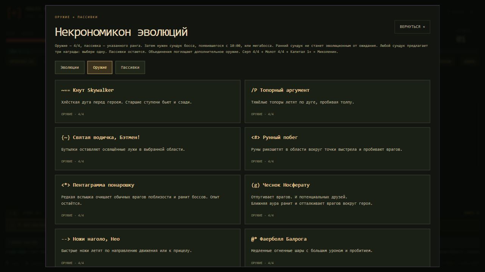

# Контент игры

Здесь редактируются имена, описания и определения контента. `description` — единое поле для шуток и полезных подсказок. Старые тексты уже перенесены, пустых описаний нет.

| Файл | Содержимое |
| --- | --- |
| `heroes.json` | 30 героев: `name`, `role`, `description`, портрет `sprite`, стартовое `weapon`, характеристики, бонусы `traits` и цена `cost` |
| `weapons.json` | 33 оружия: `title`, исходное имя `baseTitle`, `description`, ASCII-значок `icon`, редкость `rarity` (`common`, `uncommon`, `rare`, `epic`, `legendary`), максимум рангов `max`; для дополнительных механик — `cooldown` и `behavior` |
| `passives.json` | 22 пассивки и их описания |
| `evolutions.json` | 22 рецепта: оружие, поглощаемые предметы, ранги пассивок, имя и описание результата |
| `enemies.json` | 40 врагов нового ростера: `name`, `description`, характеристики `stats`, движение `movement`, визуализация `visual` и время появления `firstSecond` |
| `enemies-legacy.json` | 18 прежних врагов и боссов, включая Джека-фонаря и Дара Ветров; характеристики в единицах движка |
| `permanents.json` | Улучшения «Наследия» |
| `features.json` | Покупки бестиария, Некрономикона и карты |
| `catalog-order.json` | Порядок предметов, сохраняющий прежнюю последовательность случайных предложений. Новые предметы без записи здесь добавляются в конец |

## Как писать описание

Внутри существующей записи поменяй значение поля:

```json
"description": "Отпугивает врагов. И потенциальных друзей.\nБлижняя аура ранит и отталкивает врагов вокруг героя."
```

Первая строка может быть шуткой, следующая — полезной информацией. Можно оставить один абзац. `\n` создаёт перенос строки; кавычки внутри текста записываются как `\"`. Допускается до 2000 символов. HTML и Markdown отображаются обычным текстом: оформление и скрипты из описания не выполняются.

`id` — постоянный ключ покупок, сохранений, оружия и рецептов. Для переименования меняются `name` или `title`; прежний `id` сохраняется. Ссылки `weapon`, `weapons` и `passives` используют ID, а не отображаемое имя. Порядок героев соответствует их порядку в `heroes.json`.

Описания героев видны при выборе персонажа, врагов — в бестиарии. В Некрономиконе есть три раздела: **«Эволюции»**, **«Оружие»**, **«Пассивки»**. Описания предметов также используются в предложениях уровня, наградах и подсказках слотов.



## Сборка

При публикации через GitHub Actions JSON проверяется, а браузерные каталоги генерируются автоматически. Достаточно внести правку в исходный JSON и отправить её в `main`; при неверном JSON или сломанных ссылках публикация остановится с ошибкой проверки.

Локально после редактирования выполнить:

```powershell
node build-content.cjs
node build-enemies.cjs
node verify-data.cjs
```

Результаты — `content-data.js` и `enemy-roster.js`. Они подключаются обычными script-тегами, поэтому игра по-прежнему работает при открытии `index.html` через `file://`, без запросов к JSON. Сгенерированные файлы вручную не редактируются.

Для проверки соответствия исходникам:

```powershell
node build-content.cjs --check
node build-enemies.cjs --check
```

Боевые формулы и уникальное поведение атак остались в `core.js`. Описание предмета объясняет существующую механику, а не создаёт новую. Новый тип атаки требует реализации в движке. Изменения боевых характеристик проверяются игровыми тестами; редактирование шуток и названий не меняет механику.

У стрелков в `enemies-legacy.json` можно задать положительные `projectileSpeed` и `projectileDamageScale`: скорость снаряда и долю контактного урона. Без этих полей применяются 175 и 0,8. Параметры волн и ставок ресурсов — в `enemy-system.js` и `NightBalance` в `core.js`; текущие значения описаны в [балансе](../docs/BALANCE_TUNING.md).

Новые арбалет, гаусс и плазменный миниган используют объект `projectile` в `weapons.json`: скорость, базовый урон `damage`, прибавка за ранг `rankDamage`, время жизни, радиус, пробитие и его рост, делитель ранга для дополнительных снарядов `rankCount` (0 отключает), разброс, ASCII-глиф и цвет. `splashRadius` / `splashScale` задают взрыв при попадании. Эти параметры проверяются сборкой и используются движком и отрисовкой.

Герои могут иметь `extraWeapons` (дополнительные стартовые оружия, занимающие обычные слоты) и четыре ASCII-кадра `facingSprites`: `left`, `right`, `up`, `down`. Для пушки Чозо параметр `projectile.charge` задаёт зарядку; священные метки жезла имеют отдельный сохраняемый таймер. `appearanceNotes` хранит пожелания к оформлению и не выводится как описание предмета.
