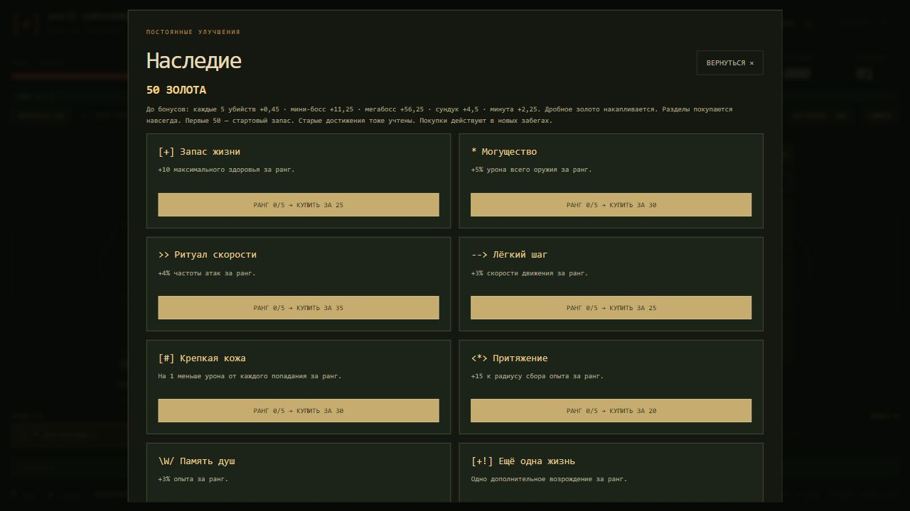

# Баланс после игрового тестирования

## Изменения

- Обычные враги оставляют полный кристалл с шансом 50%. Боссы всегда оставляют свой опыт, если награда больше нуля. Опыт сундуков и уже лежащие кристаллы не урезаны. В нагрузочном режиме выпадение гарантировано.
- Множитель золота уменьшен с 0,75 до 0,45: ставка ниже на 40% относительно предыдущей версии. Части монет накапливаются и сохраняются; купленные герои, постоянные улучшения и кошелёк остаются.
- Джек-фонарь: HP 75 → 105, контактный урон 15 → 16, множитель урона шара 0,64 → 0,8 (базовый шар 9,6 → 12,8), интервал способности 3,5 → 2,8 с, скорость шара 205 → 220. Предупреждение перед залпом и общий предел снарядов сохранены. Интервал не включает время предупреждения.
- Базовые HP обычных боссов ×2, мегабоссов ×1,8. Дар Ветров: 9 000 → 16 200. Сохранённый противник продолжает бой с прежними HP; усиление относится к новым появлениям.
- Печать всё ещё исчезает через 15 секунд или сразу после убийства босса. Более толстого босса можно добивать после снятия печати.

## Волны

Нет обязательного порога 666–999. До 06:00 обычная цель равна `24 + min(age, 360) × 0,35`; дальше прибавляется `(age − 360) × 2,25`. Здесь age — время давления, которое проклятия могут ускорять. В 06:00 цель обычной фазы 150, в 08:00 — 420, в 10:00 — 690. Первые 10 секунд минуты увеличивают цель на 12% до шестой минуты и на 25% после. Последние 12 секунд дают передышку. Защитный потолок цели обычного спавна — 2 000; боссы и призывы считаются отдельно и ограничены общим бюджетом движка.

После шестой минуты в пуле одновременно присутствуют обычная, быстрая, тяжёлая и особая роли, если они открыты по расписанию. Пятый тип — прежний противник. Размер группы растёт быстрее, интервал сокращается; опасные категории получают более высокие квоты. Обычные враги получают дополнительный множитель HP `1 + max(0, age − 360) / 300`, то есть ×1,4 к восьмой минуте поверх прежнего масштабирования. Дополнительная скорость растёт до +15%. Нагрузочный режим использует отдельный прежний спавн.

## Сравнительные прогоны

Команда: `node balance-benchmark.cjs [путь-к-json]`. Четыре прогона по восемь минут: seed 811 и 427, без метаулучшений и с максимальными рангами. Герой Клык, реальные спавн, препятствия и боссы, шаг 0,05 с. Бот идёт к ближайшему кристаллу или сундуку и выбирает улучшения по одинаковому списку предпочтений. Бот неуязвим, чтобы смерть не обрывала сравнение ресурсов. Это проверка темпа прокачки, а не доказательство сложности, выживаемости или FPS браузера. Изменение выпадений меняет последовательность RNG и предложенные сборки, поэтому пары не являются сравнением одинакового оружия.

| Мета | Seed | Уровень до → после | Золото до → после | Убийства до → после |
| --- | --- | --- | --- | --- |
| Нет | 811 | 30 → 22 | 3 724 → 535 | 17 177 → 5 400 |
| Нет | 427 | 29 → 23 | 2 455 → 736 | 15 349 → 5 877 |
| Максимум | 811 | 31 → 25 | 4 701 → 1 121 | 19 043 → 7 889 |
| Максимум | 427 | 30 → 21 | 2 520 → 668 | 15 776 → 5 669 |

Полные данные: [balance-comparison.json](balance-comparison.json), прежняя версия `e50e2c09cb166cf1f6ce7ae2c74ef468e6b4d623`. Суммарное золото падает сильнее ставки: изменились количество убийств, боссов и бонусы выбранного билда. Темп уровней замедлился; дальнейшая оценка силы волн требует обычных забегов с получением урона.

`verify-balance.cjs` проверяет границу 50%, гарантированный опыт боссов и нагрузочного режима, нулевые кристаллы, счётчики фактического выпадения, дробное золото при загрузке, усиление скорости обоих наборов врагов, HP после шестой минуты и сохранение текущего боя. `verify-arena.cjs` отдельно проверяет таймер стены и возможность убить усиленного босса обычным оружием.

