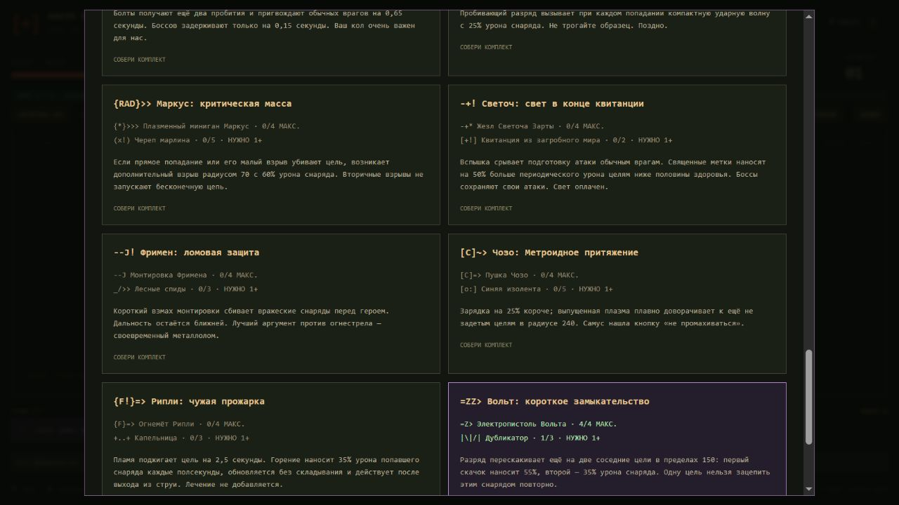

# Полное покрытие эволюциями

В игре 33 базовых оружия, 31 рецепт и 22 пассивки. Каждое оружие участвует в эволюции или одном из двух объединений: Серп + Молот и обе птицы. Каждая пассивка используется хотя бы в одном рецепте.

Для девяти новых рецептов нужны оружие 4/4 и пассивка 1+. Эволюция выбирается из подходящего сундука босса после 10:00 или мегабосса. Начальный сундук не эволюционирует от ожидания. Лимиты 5+5 и выбор одной награды из трёх сохранены.

| Оружие | Пассивка | Эволюция | Что меняется |
|---|---|---|---|
| Арбалет Ван Дер Хельсинга | Шило навылет | Ван Дер Хельсинг: осиновый колл-центр | Болты получают ещё два пробития и пригвождают обычных врагов на 0,65 секунды. Боссов задерживают только на 0,15 секунды. Ваш кол очень важен для нас. |
| Гаусс Полураспад | Ускоритель частиц с AliExpress | Гаусс: резонансный каскад | Пробивающий разряд вызывает при каждом попадании компактную ударную волну с 25% урона снаряда. Не трогайте образец. Поздно. |
| Плазменный миниган Маркус | Череп марлина | Маркус: критическая масса | Если прямое попадание или его малый взрыв убивают цель, возникает дополнительный взрыв радиусом 70 с 60% урона снаряда. Вторичные взрывы не запускают бесконечную цепь. |
| Жезл Светоча Зарты | Квитанция из загробного мира | Светоч: свет в конце квитанции | Вспышка срывает подготовку атаки обычным врагам. Священные метки наносят на 50% больше периодического урона целям ниже половины здоровья. Боссы сохраняют свои атаки. Свет оплачен. |
| Монтировка Фримена | Лесные спиды | Фримен: ломовая защита | Короткий взмах монтировки сбивает вражеские снаряды перед героем. Дальность остаётся ближней. Лучший аргумент против огнестрела — своевременный металлолом. |
| Пушка Чозо | Синяя изолента | Чозо: Метроидное притяжение | Зарядка на 25% короче; выпущенная плазма плавно доворачивает к ещё не задетым целям в радиусе 240. Самус нашла кнопку «не промахиваться». |
| Огнемёт Рипли | Капельница | Рипли: чужая прожарка | Пламя поджигает цель на 2,5 секунды. Горение наносит 35% урона попавшего снаряда каждые полсекунды, обновляется без складывания и действует после выхода из струи. Лечение не добавляется. |
| Электропистоль Вольта | Дубликатор | Вольт: короткое замыкательство | Разряд перескакивает ещё на две соседние цели в пределах 150: первый скачок наносит 55%, второй — 35% урона снаряда. Одну цель нельзя зацепить этим снарядом повторно. |
| Гигаперчатки: кулачный аргумент | Доспех | Дум-фисты: кулак и порядок | Комбинация кулаков выпускает короткую направленную ударную волну до 220, наносящую 45% урона одного удара и отбрасывающую врагов. В ближнем бою за правопорядком следят костяшки. |

Пассивки сохраняются после эволюции. Квитанция не расходуется ради жезла: её обычные возрождения продолжают работать. Горение не складывается, дополнительный плазменный взрыв не запускает новую цепь, боссы сохраняют подготовку атак, монтировка остаётся ближним оружием. Новые формы не меняют темп получения опыта и золота.

В Некрономиконе на карточках оружия и пассивок перечислены связанные эволюции. В песочнице выберите любое оружие и включите «Эволюция»: нужные ингредиенты будут выданы автоматически; рядом показаны название и эффект. Можно выбирать и вторую половину объединения — Молот или вторую птицу.

Электрические цепи и электропистоль рисуются ярко-синим, опыт — светло-голубым. В авто-режиме цвет выбранного слота не перекрашивает атаки постоянно; наведение и ручной режим по-прежнему подсвечивают оружие красным.

Проверки: все 31 рецепта через сундук и JSON-сохранение, отсутствие оружия/пассивок без связок, эффекты девяти новых форм, ограниченные цепи и контроль боссов, горение после перезагрузки и отклонение повреждённых состояний. Получасовой игровой баланс требует отдельного прогона.
