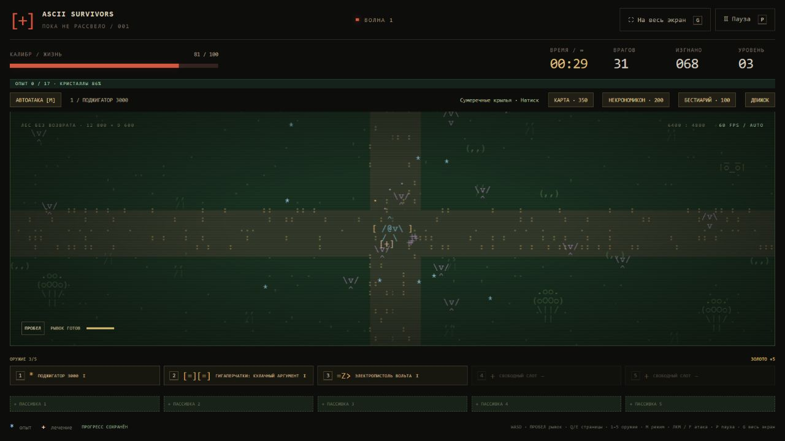

# Лес без возврата

Референсы: [план Mad Forest](https://vampire.survivors.wiki/images/Tilemap-Mad_Forest.png?5476d), [описание и расписание волн](https://vampire.survivors.wiki/w/Mad_Forest). Взяты открытая планировка, перекрёсток, редкие препятствия, водоёмы, сад и принцип смены состава по минутам. ASCII-силуэты и геометрия нарисованы в коде; используется наш бестиарий и наш баланс.

На стартовом экране выбери арену «Лес без возврата». Кладбище тоже доступно. Весь мир 12 800 × 9 600, ориентиры повторяются участками 3 200 × 2 400. Стартовый перекрёсток и обе главные дороги свободны. Сосны, дубы, пни и камни — твёрдые препятствия, вода и цветы — проходимые декорации. Под печатью босса препятствия временно отключаются, как на кладбище.

Карта сокровищ показывает дороги, пруды, сады и доступные тайники. Её постоянное открытие за золото продолжает работать. Песочница позволяет проверять эффекты на фоне любой выбранной арены, но без препятствий.

| Минута | Волна | Враги |
|---|---|---|
| 0:00 | Сумеречные крылья | Могильная мышь |
| 1:00 | Мёртвая поступь | Зомби, Могильная мышь |
| 2:00 | Мышиная метель | Могильная мышь, Летучая мышь |
| 3:00 | Костяная тропа | Скелет, Костяной ходок |
| 4:00 | Блуждающие огни | Скелет, Фонарный призрак |
| 5:00 | Плесневый покров | Плесневый мертвец, Гробовой ползун |
| 6:00 | Гниющая чаща | Зомби, Плесневый мертвец |
| 7:00 | Налёт над трясиной | Летучая мышь, Могильная мышь, Гробовой ползун |
| 8:00 | Шествие мертвецов | Зомби, Плесневый мертвец |
| 9:00 | Ночная стая | Летучая мышь, Зомби, Чёрная гончая |
| 10:00 | Гробовая сырость | Плесневый мертвец, Гробовой ползун |
| 11:00 | Костяной ливень | Скелет, Костяной ходок, Кричащий череп |
| 12:00 | Лунная охота | Оборотень, Фонарный призрак, Скелет |
| 13:00 | Призрачный вой | Оборотень, Фонарный призрак |
| 14:00 | Крылья и клыки | Летучая мышь, Оборотень, Чёрная гончая |
| 15:00 | Голодный лес | Оборотень, Летучая мышь, Плесневый мертвец |
| 16:00 | Мясная просека | Мясник часовни, Гробовой ползун, Плесневый мертвец |
| 17:00 | Погребальные бинты | Мумия, Громила |
| 18:00 | Гробовой обоз | Мумия, Гробовой ползун |
| 19:00 | Железная погребальная | Мумия, Гробовой ползун, Железный мученик |
| 20:00 | Стая над склепом | Мумия, Плесневый мертвец, Летучая мышь |
| 21:00 | Похоронный сад | Труп невесты, Скорбящая монахиня, Гниющий хор |
| 22:00 | Траурный венок | Труп невесты, Мумия |
| 23:00 | Чёрная процессия | Скорбящая монахиня, Мумия |
| 24:00 | Сад забвения | Труп невесты, Мумия, Плесневый мертвец |
| 25:00 | Красный урожай | Великий мученик, Джек-о-Лантерн, Оборотень |
| 26:00 | Пылающая изгородь | Джек-о-Лантерн, Труп невесты, Громила |
| 27:00 | Последний обоз | Мумия, Гробовой ползун, Плесневый мертвец |
| 28:00 | Кровавые крылья | Летучая мышь, Чёрная гончая, Кричащая корона |
| 29:00 | Лес не отпускает | Могильная мышь, Летучая мышь, Чёрный рыцарь |

После 30:00 циклически используются составы 24–29, а давление продолжает расти до защитных лимитов. Рост численности после 06:00 и квоты стрелков, особых и элит сохранены. Проклятие усиливает давление, но не перематывает поминутный состав вперёд. Боссы используют существующее расписание и здоровье; отдельные события Mad Forest и его финал в 30:00 не перенесены.

Поле mapId добавлено в снимок забега без смены версии: старый снимок без него означает кладбище. Неизвестное значение отклоняется. При смене карты кеш отрисовки сбрасывается.
