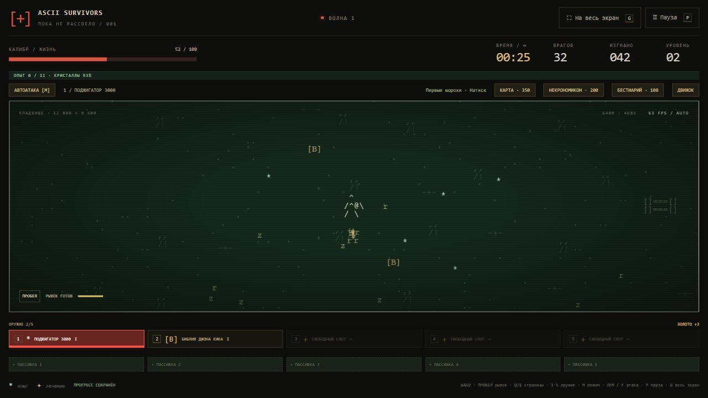

# Более медленная прокачка и аудит арсенала

Версия после игрового отзыва 18 октября 2026. Пересмотрены все 33 оружия и 22 пассивки.

## Опыт и лечение

Каждая награда опыта умножается на `1 / (1 + 0,08 × (уровень − 1))`, затем на бонус Роста и «Наследия». Это относится к кристаллам и наградам опыта из сундуков. Значения на земле и уже полученный опыт не переписываются. Дробный остаток накапливается и сохраняется, поэтому мелкие кристаллы не становятся бесполезными. Стоимость следующего уровня теперь растёт по `ceil(предыдущая × 1,22 + 3)`, с прежним потолком 5000. Первый уровень по-прежнему требует 6 XP.

| Уровень героя | Опыт от того же кристалла до бонусов |
| --- | ---: |
| 1 | 100% |
| 5 | 75,8% |
| 10 | 58,1% |
| 20 | 39,7% |

Над полем показан текущий процент. Обычные враги по-прежнему оставляют кристалл с шансом 50%, боссы — гарантированно при ненулевой награде.

Аптечки: 1,75% → **0,875% × удача** для обычных врагов; 50% → **25%** для боссов. Это ещё одно сокращение выпадения ровно на 50% при той же удаче. Размер лечения не изменён.

## Оружие

Общий множитель кулдауна 0,65 → **0,85**: интервалы стали на 30,8% длиннее, частота ниже на 23,5% до остальных бонусов. Ускорение от каждого дополнительного ранга иглы и дополнительных оружий снижено с 12% до 5%. Общий бонус урона и скорострельности пассивок на максимуме даёт около ×2,1 вместо ×12,1 без учёта остальных эффектов.

`damageMultiplier` в JSON применяется один раз при попадании, включая дот, взрывы и эволюции. Таблица показывает коэффициент к формулам урона и интервалы первого ранга без пассивок. У шести баллистических оружий также отдельно уменьшен прирост урона по рангам. Клинки здесь показывают минимальный интервал контакта, яд — интервал создания лужи, а не её тиков.

| Оружие | Коэффициент урона | Интервал до → после, с |
| --- | ---: | ---: |
| Кнут Новой надежды | 85% | 0.747 → 0.977 |
| Топорики Т-77 | 80% | 1.300 → 1.700 |
| Крещёная минералка | 75% | 1.820 → 2.380 |
| Скандинавский пинбол | 80% | 1.365 → 1.785 |
| Игрушечный пентакль | 100% | 15.600 → 20.400 |
| Кадило на цепи | 85% | 0.520 → 0.680 |
| Ножи 47-й аргумент | 90% | 0.293 → 0.383 |
| Фаерболл Балрога | 85% | 1.430 → 1.870 |
| Луч Доктора Что? | 100% | 1.560 → 2.040 |
| Божья страховка | 85% | 4.550 → 5.950 |
| Библия Джона Кика | 75% | 2.470 → 3.230 |
| Летучая мышь из Китая | 85% | 1.235 → 1.615 |
| Лапки бэтмена | 85% | 1.235 → 1.615 |
| Молот Бора | 80% | 1.365 → 1.785 |
| Пистоль, Джеймс Пистоль | 95% | 0.585 → 0.765 |
| Праща пращуров | 95% | 0.845 → 1.105 |
| Поджигатор 3000 | 95% | 0.442 → 0.578 |
| Кольца мясорубки | 75% | 0.227 → 0.297 |
| Стигийский мегафон | 85% | 3.250 → 4.250 |
| Карманная катушка Теслы | 85% | 1.560 → 2.040 |
| Серп | 85% | 1.105 → 1.445 |
| Сигил Деда Мороза | 90% | 2.730 → 3.570 |
| Метеоритный дождь | 85% | 2.080 → 2.720 |
| Язва Чужого | 80% | 0.488 → 0.637 |
| Арбалет Ван Дер Хельсинга | 90% | 0.813 → 1.063 |
| Гаусс Полураспад | 90% | 1.625 → 2.125 |
| Плазменный миниган Маркус | 80% | 0.117 → 0.153 |
| Жезл Светоча Зарты | 70% | 2.080 → 2.720 |
| Монтировка Фримена | 90% | 0.715 → 0.935 |
| Пушка Чозо | 85% | 1.170 → 1.530 |
| Огнемёт Рипли | 85% | 0.130 → 0.170 |
| Электропистоль Вольта | 90% | 0.455 → 0.595 |
| Гигаперчатки: кулачный аргумент | 85% | 0.715 → 0.935 |

Особые правки:

- Пентаграмма наносит конечный урон: обычным врагам `60 + 35 × ранг`, боссам `110 + 40 × ранг` до Силы; эволюция усиливает удар в 1,5 раза. Враг с большим HP больше не стирается автоматически. Активация не создаёт бесплатный опыт; притягивание существующих кристаллов эволюцией сохранено.
- Заморозка боссов ограничена: до 0,6 с для ледяной эволюции и до 0,8 с для луча; мегабоссов — 0,35 с. Обычный холод короче.
- Лечение критическим кнутом ограничено 3 HP за активацию, эволюцией кадила — 0,5. Кража жизни Некроморфа сохраняет резерв 2 HP и лимит 1 HP за попадание, но резерв пополняется на 0,6 HP/с вместо 2.
- Короткая дальность монтировки/перчаток и роли контрольного оружия сохранены. Старт Электропистоля оставлен пригодным для ранней слабой нечисти; его прирост по рангам уменьшен.

## Все пассивки

| Предмет | Решение |
| --- | --- |
| Гематоген из девственниц | Было ×1,35 за ранг; стало +10% базового урона за ранг (максимум ×1,5). |
| Методичка по скорострельности | Было ×1,22 за ранг; стало +8% базовой частоты за ранг (максимум ×1,4). |
| Дубликатор | +1 совместимый снаряд / клинок / удар за ранг, до трёх. Количество оставлено; урон и темп самого оружия снижены. |
| Лесные спиды | +15% → +8% скорости за ранг; множитель кулдауна рывка 0,9 → 0,95 за ранг. |
| Пылесос душ | +30 → +20 радиуса сбора за ранг. |
| Допельхертц | +25 максимального HP сохранены; мгновенное лечение 40 → 20 за ранг. |
| Капельница | 0,7 → 0,2 HP/с за ранг (максимум 0,6). |
| Шило навылет | +1 пробитая цель за ранг сохранена: важная специализация против толпы. |
| Люстра Судного дня | +12% → +6% радиуса за ранг. |
| Синяя изолента | +15% → +8% длительности за ранг. |
| Ускоритель частиц с AliExpress | +12% → +8% скорости снарядов за ранг. |
| Доспех | −2 → −1 урона за ранг; броня поглощает максимум 75% попадания, минимум урона 1. |
| Красный диплом | +10% → +5% опыта за ранг. Не отменяет снижение ценности кристалла с уровнем. |
| Карманный рандом | +10% удачи за ранг сохранены; базовый шанс аптечки теперь вдвое ниже. |
| Кэшбек святого Петра | +15% золота за ранг сохранены. |
| Череп марлина | +10% давления и +20% золота за ранг сохранены: это осознанный риск. |
| Квитанция из загробного мира | +1 возрождение за ранг сохранено. |
| Минутная стрелка | +10% области / +5% времени → +5% / +3% за ранг. |
| Часовая стрелка | +8% давления и +10% золота за ранг сохранены. |
| Полис «Жизнь» | +10 HP сохранены; 0,2 → 0,1 HP/с за ранг. |
| Полис «Франшиза» | +8% давления и +10% золота за ранг сохранены. |
| Капитал | +15% золота за ранг и роль катализатора Миколенина сохранены. |

Покупки «Наследия», цены, открытые герои, кошелёк и заработанное золото сохранены. Максимальное HP от уже взятых рангов не пересчитывается. Новый баланс применяется к текущим формулам боя и будущему получению опыта; формат сохранения остаётся v10.

## Сравнение прогонов

Команда: `node balance-benchmark.cjs путь-к-json`. Для старого каталога можно задать `NIGHT_GAME_ROOT` с папкой старых файлов. По 12 прогонов до и после: Калибр, Рипли, Фримен; seed 811/427; без «Наследия» и с максимальными рангами. Бот неуязвим, препятствия выключены, шаг 0,05 с; он собирает опыт и сундуки и использует одинаковые предпочтения усилений. Это сравнение темпа прогрессии, а не измерение выживаемости игрока или FPS.

| Герой | Средний уровень в 08:00 до → после |
| --- | ---: |
| Калибр | 23.50 → 18.75 |
| Рипли | 21.50 → 19.25 |
| Фримен | 23.00 → 18.75 |

Средний уровень по всем прогонам: **22,67 → 18,92**. Подбор выпадений и сборок меняется вместе с RNG; встречаются отдельные прогоны с большим числом убийств из-за проклятий и иной сборки. Поэтому цифры не означают равномерное снижение убийств или фиксированный процент усложнения. Полные результаты и промежуточные точки: [progression-comparison.json](progression-comparison.json).

Проверки покрывают 33 источника урона, все 30 стартовых наборов, новые коэффициенты и дробный опыт после загрузки, границы выпадения аптечек, линейные пассивки, броню/лечение, отсутствие бесплатного XP пентаграммы, один множитель прямого и взрывного урона и старые сохранения.
