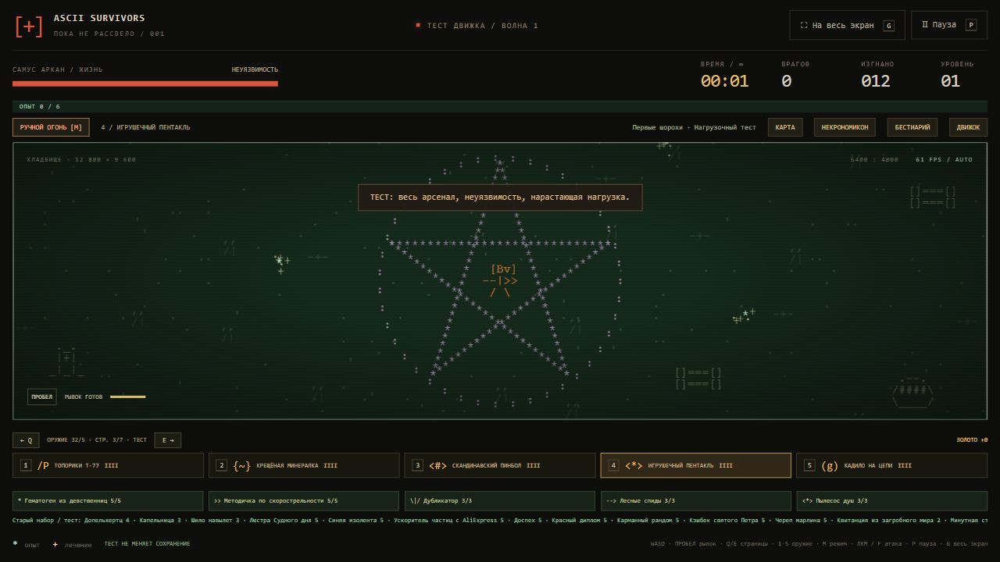
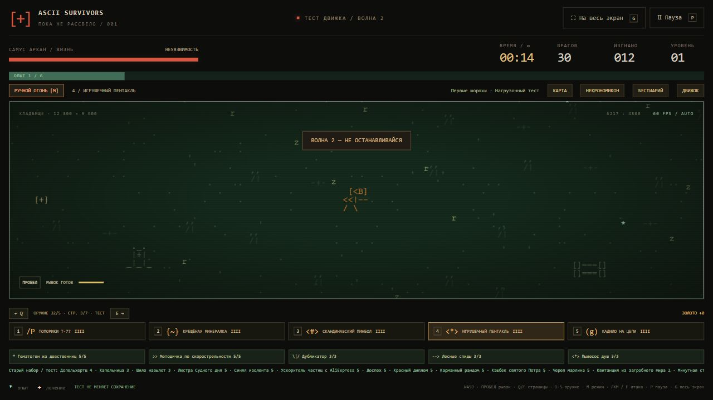

# Авторские правки, 18 октября 2026

Перенесены названия и описания из четырёх листов двух авторских таблиц: оружие, герои, пассивки, враги. Сопоставление выполнено по ID, а не по названию или номеру строки. Если заполнено «Твоё описание», используется оно; иначе используется отредактированное «Текущее описание». Комментарии о внешнем виде отделены от пользовательского текста. Явные опечатки, повтор заголовка и служебные примечания в описаниях очищены.

## Внешний вид

- Герой использует четыре ASCII-кадра по последнему направлению движения. Меняются взгляд и боковой силуэт; сохраняются знак героя и цвет. При остановке направление остаётся прежним, курсор ручного прицела его не меняет. Направление сохраняется вместе с забегом.
- Кнут Новой надежды рисует синие дуги с обеих сторон. Уже первый ранг бьёт перед героем и сзади.
- Крещёная минералка оставляет синие лужи с синими деталями.
- Скандинавский пинбол меняет рунические ASCII-знаки в полёте.
- Игрушечный пентакль рисует пятиконечную ASCII-пентаграмму на области атаки; эмблема вписывается в экран, чтобы пять лучей были видны даже при большой области. Радиус урона остаётся прежним.
- Летучая мышь из Китая использует красную анимированную мышь, Лапки бэтмена — синюю.
- Топорики Т-77 сохранили прежнюю анимацию.

## Стартовые наборы и способности

| Герой | Новый набор / изменение |
| --- | --- |
| Светоч Лана | Жезл Светоча Зарты: широкий священный удар и четырёхсекундная метка с отдельными тиками урона. Метка следует за целью после выхода из области. |
| Самус Аркан | Пушка Чозо: сначала заряжается, затем стреляет пробивающей плазмой. Ранги ускоряют заряд, увеличивают урон, размер и пробитие. Герой получает два дополнительных снаряда; сохраняет +2 брони. |
| Фримен | Гаусс Полураспад и Монтировка Фримена: два обычных слота. Монтировка бьёт вблизи и отбрасывает. Базовое здоровье 100, +2 брони. |
| Ван Дер Хельсинга | Арбалет и Скандинавский пинбол: два обычных слота, +10% области. |
| Рипли | Огнемёт: частый короткий поток пламени вместо прежних дальних фаерболлов. |
| Вольт | Электропистоль: быстрые синие разряды. |
| Некроморф | Язва Чужого и кража жизни: 2% фактически снятых кислотой HP, не больше 1 HP за попадание. Урон сверх здоровья цели не лечит. Лечение тратит запас 2 HP, пополняемый на 2 HP/с: большая толпа не даёт безграничного лечения. Остаток запаса сохраняется. |
| Волтбой 13 | Плазменный миниган Маркус. |
| Брюс Не-Уэйн | Синяя летучая мышь; базовые HP 90 → 120, скорость 185 → 175. |
| Лунакраса | Красная летучая мышь. |
| DJ Харон | Стигийский мегафон. |

Всего 32 оружия. Новые пять имеют четыре ранга, работают в ручном и автоматическом режимах и поддерживают применимые бонусы. Они не добавляют эволюций: рецептов по-прежнему 22. Два стартовых оружия занимают два из пяти слотов. Пылесос душ теперь даёт +30 к радиусу за ранг по таблице вместо прежних +65. Прочие численные характеристики пассивок сохранены.

## Сохранения и проверки

Снимок версии 9 принимает прежние версии 1–8. ID героев и предметов, цены, кошелёк и постоянные покупки не меняются. Старый забег сохраняет заработанное оружие и HP, даже если новый стартовый набор героя другой. Новые стартовые наборы выдаются при новом забеге. Заряд Чозо и священные метки сохраняются в полёте; не наносят повторный стартовый урон при загрузке.

Проверено 30 реальных снимков, созданных кодом предыдущей публикации `573037583d6908a0c31e400f2a113c378594e079`: сохранены HP, золото, старое оружие, незавершённые предложения улучшений и возможность повторно сохранить/загрузить забег.

`node verify-sheet-edits.cjs` проверяет направления, остановку и ручной прицел, два удара кнута, священный DoT, заряд и бонус Самус, кражу жизни без overkill, радиус Пылесоса и миграцию изменённых героев. Остальные 13 наборов тестов сохранены.

