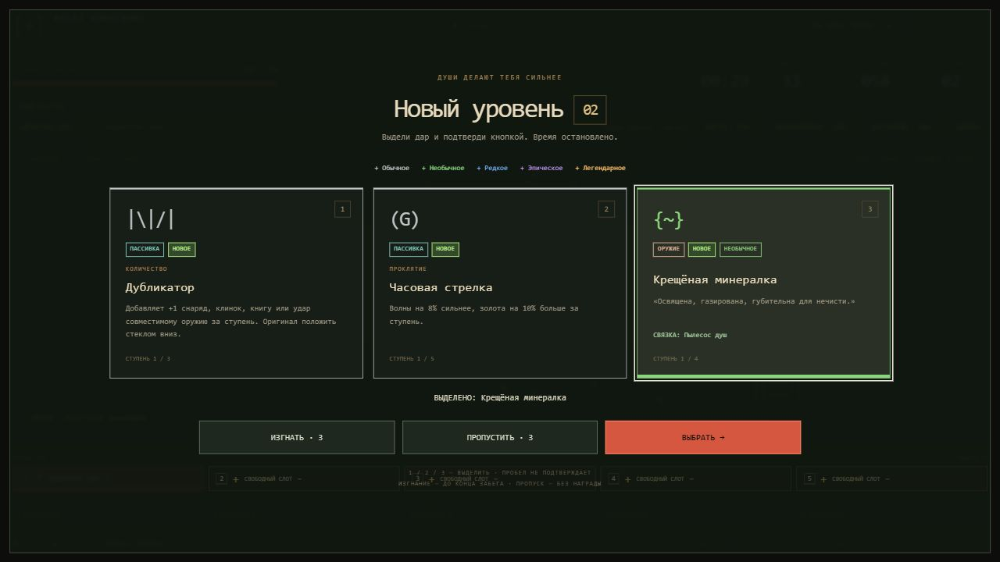
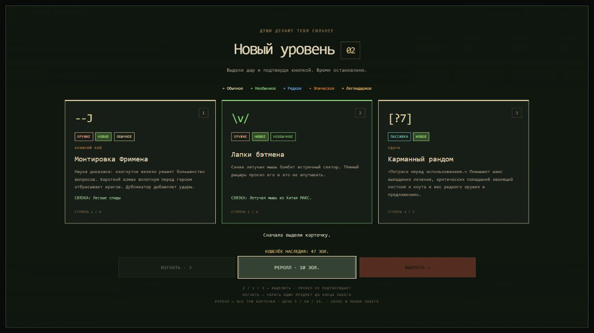
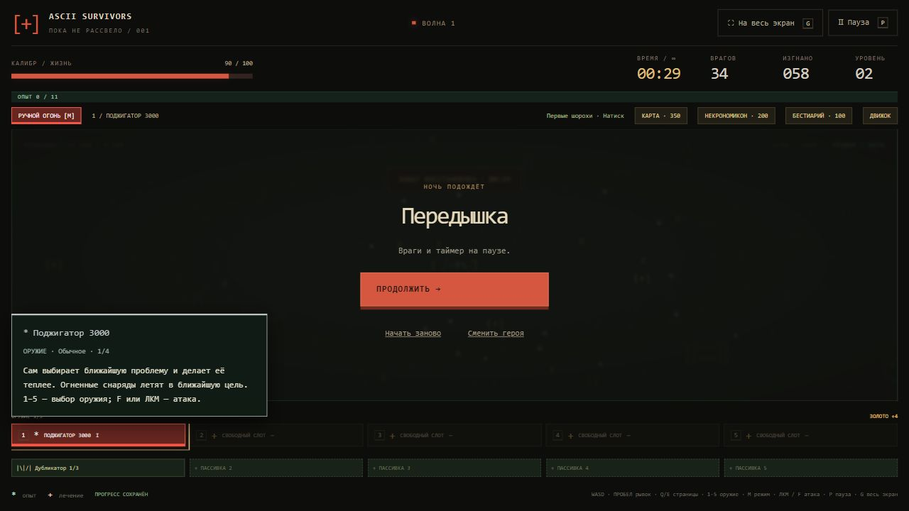
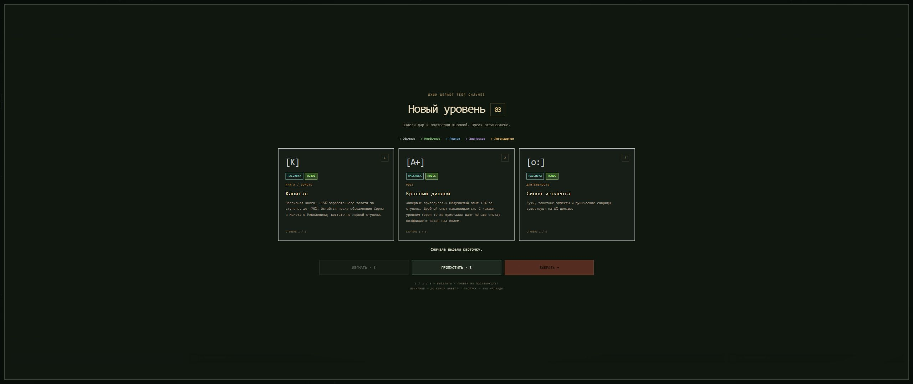
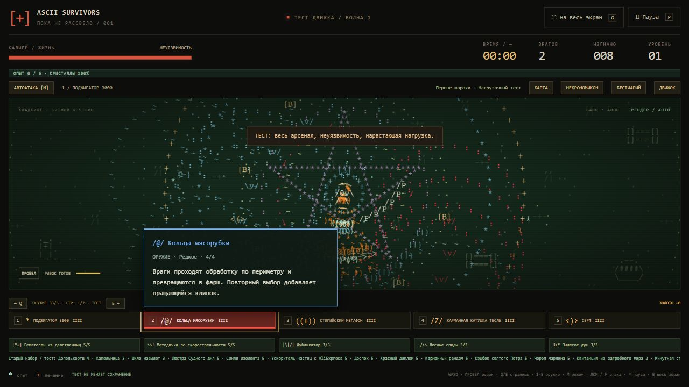
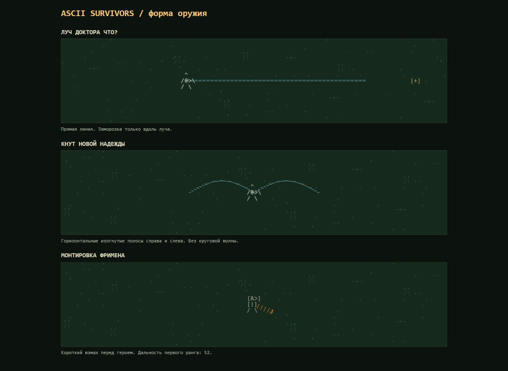

# Усиления, подсказки и ближний бой

На новом уровне сначала выделяется карточка (мышью или 1/2/3), затем нажимается «Выбрать». Пробел в этом окне полностью игнорируется, в том числе на самой кнопке подтверждения. Tab и Enter позволяют пользоваться кнопками с клавиатуры. До выбора время остановлено. Выделение не выдаёт предмет.

Окно усилений открывается как модальный `dialog` в верхнем слое браузера: HUD и нижняя панель не перекрывают карточки и кнопки даже в развёрнутом режиме. Весь экран и страница не прокручиваются. На тесном экране прокручивается только список карточек; выбор, изгнание и реролл остаются видны. Escape не закрывает обязательный выбор, фокус остаётся внутри диалога.

## Редкость

Поле `rarity` каждого оружия находится в `data/weapons.json`. Цвет, название и базовый вес определены в `catalog.js`.

| Значение | Цвет | Вес одного предмета |
| --- | --- | ---: |
| `common` | Бледно-жёлтый | 100 |
| `uncommon` | Зелёный | 65 |
| `rare` | Синий | 35 |
| `epic` | Ярко-оранжевый | 16 |
| `legendary` | Янтарный | 6 |

Это относительные веса предметов, не проценты выпадения категории. На уровне приоритет — два оружия и одна пассивка, если доступны подходящие варианты. Пока есть свободный оружейный слот, одна карточка предлагает новое оружие. Если категория исчерпана, свободные карточки заполняются другой. Все 33 оружия участвуют; после заполнения пяти слотов доступны только ранги уже взятых оружий. Выбор происходит без повторов среди допустимых усилений. Например, без удачи конкретный обычный предмет весит в 16,7 раза больше конкретного легендарного внутри оружейного пула. Пассивки имеют вес 100, кроме обеих стрелок и обоих полисов: у них `offerWeight: 25`. Сильные массовые атаки и пушки получили верхние редкости; это ручная начальная оценка для дальнейшей настройки баланса, а не пересчёт DPS.

Та же система действует на случайные улучшения из сундуков. Сундуки сохраняют приоритет уже взятого оружия и гарантированных готовых эволюций. Начальное оружие героя, ограничения 5+5 и наличие нового оружия в первом предложении сохраняются.

«Карманный рандом» повышает вес оружия выше обычного: множитель `1 + (удача − 1) × индекс редкости`, где индекс 0–4. На пятом ранге легендарный вес равен 18, обычный остаётся 100. В «Наследии» покупки удачи пока нет.

Карточки отдельно показывают **ОРУЖИЕ / ПАССИВКА**, зелёное **НОВОЕ** для ещё не взятого предмета, текст редкости и категорию эффекта (область, количество, проклятие и другие). У всех 55 предметов собственный ASCII-значок; сборка проверяет, что значки не повторяются.

## Изгнание и платный реролл

- Три изгнания на забег: выбранное усиление больше не предлагается до его конца. Уже взятые ранги продолжают действовать; готовая эволюция остаётся доступной. Карточка заменяется, если есть подходящий предмет. Выбор уровня сохраняется. Когда замен больше нет, карточка исчезает; если не осталось ни одной, бой продолжается без награды.
- Вместо пропуска — полный реролл: 5, 10, 15, 20… золота из общего кошелька «Наследия». Цена растёт за каждый реролл в забеге и сбрасывается в новом. Все текущие карточки исключены из следующего набора; уровень и время не тратятся. Если золота или полного набора замен недостаточно, кнопка недоступна и списания нет.
- Баланс, цена и оплаченные карточки сохраняются после перезагрузки. Запись оплаты содержит карточки для восстановления при прерванном сохранении забега. Ошибка записи оплаты отменяет реролл.
- Выбор карточки, изгнания, рероллы и исключённые предметы входят в сохранение версии 10. Старые забеги без счётчика рероллов начинают с цены 5. Старые наборы оружия Фримена сохраняются.

`node verify-reroll.cjs` проверяет весь оружейный пул, состав предложений, отсутствие повторов после реролла, рост цены, нехватку золота и восстановление оплаченного выбора при ошибке записи.

## Подсказки и оружие

Слоты оружия и пассивок показывают оформленную подсказку при наведении и клавиатурном фокусе. Она содержит значок, название, тип, редкость оружия, текущий ранг и полное авторское описание с шуткой. Для эволюции дополнительно показано её действие, исходное описание сохраняется. Подсказка находится над интерфейсом и в развёрнутом режиме. Escape скрывает её.

Наведение на оружие подсвечивает красным и слот, и принадлежащие ему эффекты на поле: снаряды, следы, дуги, орбиты, книги, лужи, зарядку, области и частицы взрывов. Активное оружие при просмотре другого слота не переключается. После ухода указателя подсветка возвращается к выбранному оружию. Клик и цифры выбирают активный слот; подсветка работает в автоматическом и ручном режимах. Другие оружия сохраняют свои цвета. Просмотр не влияет на урон, частоту или геометрию атак.

- **Фримен** начинает с одной монтировкой: ближний взмах с отбрасыванием. Гаусс можно найти во время забега.
- **Рипли** начинает с огнемётом. Снаряды рисуются мерцающими оранжевыми языками пламени с жёлтым следом.
- **Гигаперчатки: кулачный аргумент** — новое необычное оружие ближнего боя. Два удара перед героем отбрасывают врагов; сзади и на расстоянии не достают. Дубликатор добавляет удары в комбинацию, Область увеличивает досягаемость. Базовый интервал 1,1 с до общего множителя перезарядки и усилений.

Проверки: `node verify-upgrades.cjs` покрывает веса и удачу, уникальность значков, выбор без выдачи награды, заряды и исключения, переполнение опыта, сундуки, миграцию v9, сохранение выбора, стартовые наборы, направленные удары и визуальные эффекты огнемёта/перчаток. В браузере проверены случайный пробел, продолжение после перезагрузки, изгнание, подтверждение, подсказки и ручной режим.

Проверка подсветки охватывает атаки всех 33 оружий, восстановление исходных цветов, отсутствие перекраски другого оружия и сохранение источника отложенных взрывов. Проверки размеров окна: 2560×1080, 945×480 и 390×640; у диалога и страницы нет прокрутки, кнопки доступны. На небольших экранах есть только прокрутка карточек.

## Форма луча и ближних атак

- Обычный выстрел Луча Доктора Что — прямая голубая линия длиной `480 × Область`, без зигзага и круговой волны. Заморозка проверяется по расстоянию до конечного отрезка. Автоматический режим поворачивает направление между выстрелами. Отдельный разряд эволюции после полного оборота сохранён.
- Кнут бьёт двумя узкими изогнутыми горизонтальными полосами вправо и влево, даже при вертикальном прицеливании. Полоса постепенно раскрывается от героя к концу. Урон проверяется по тем же сегментам, которые рисует анимация; сверху и снизу кругового урона нет. Дубликатор добавляет параллельные полосы.
- Монтировка имеет короткий стержень и загнутый конец `J`. Дальность — 52–64 мировые единицы по рангам, с Областью максимум 96. Взмах и урон ограничены передним сектором; удалённые враги недоступны.

Проверки геометрии входят в `verify-sheet-edits.cjs`: попадания на линии и промахи вне неё, горизонтальный кнут при вертикальном прицеле, конечная дальность, Дубликатор, отсутствие лишних кругов и короткая монтировка. Старые сохранения и эволюции совместимы.

