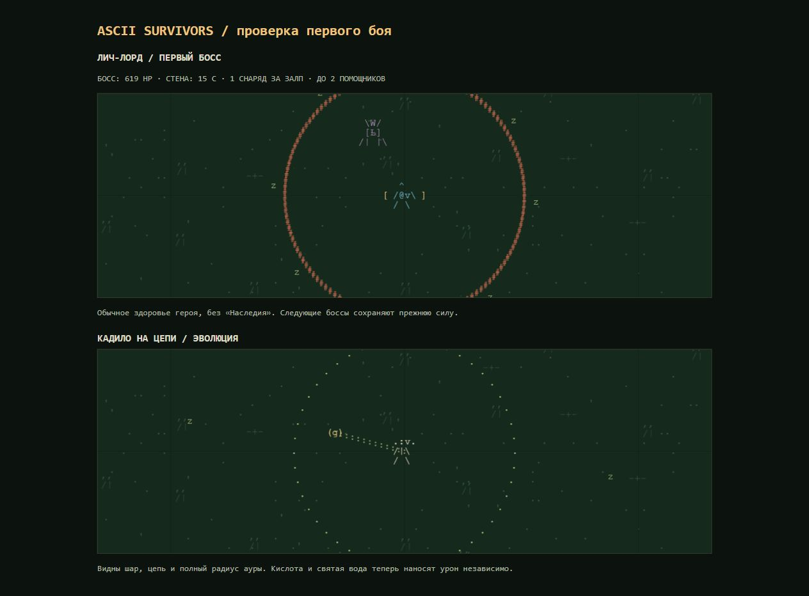

# Проверка арсенала и первого босса

Проверка исходников, попаданий, рисунка атак, 22 пассивок и 22 эволюций. Автоматические прогоны всех 33 оружий: ранги 1/4, Дубликатор 0/1, авто/ручной режим, неподвижная цель на расстоянии 50/100/200/400. Контроль и щит учитываются отдельно от урона. Прицел и последнее движение направлены вправо: автоматические ножи следуют направлению движения.

Команда: `node audit-weapons.cjs docs/weapon-audit.json`. [Полные результаты](weapon-audit.json). Интервал измерения — 20 секунд, включая первую готовую атаку. Это проверка работоспособности и дальности, не рейтинг силы: кольцу, кислотному следу, птицам и пробивающему залпу нужны разные позиции и плотность толпы. По одному манекену нельзя оценить массовый урон, выживаемость или FPS.

## Исправленные ошибки

- **Топор первого ранга:** прежняя фиксированная вертикальная скорость переносила траекторию над выбранной целью. В четырёх горизонтальных позициях манекена было 0 попаданий. Теперь начальная скорость учитывает дальность и гравитацию; на тех же позициях получается 21–23 DPS первого ранга. Дуга, пробитие, разброс дополнительных топоров и эволюционные косы сохранены.
- **Вода + кислота:** общий `poisonAt` заставлял одну семью луж блокировать другую. У воды отдельный сохраняемый таймер. Лужи одной семьи по-прежнему не складываются безгранично.
- **Метеоры:** количество раньше ограничивалось количеством различных целей. Теперь все положенные рангом и Дубликатором метеоры появляются и против одного босса.
- **Молот:** раньше выбирал противника за 340 единиц, хотя был описан как ближний удар. Теперь место удара находится не дальше `130 × Область` от героя; взрыв вокруг него сохранён.
- **Клинки в ручном режиме:** видимые взмахи и попадания теперь используют одинаковые направления, угол и дальность. В авто-режиме ранг добавляет орбитальный клинок; в ручном усиливает направленную атаку. Это явно указано в описании.
- **Кадило:** добавлены шар и цепь внутри ауры. Отрисовка эволюции теперь учитывает увеличенный радиус. Шар декоративен, а урон наносит вся дымная аура — это явно указано в описании.
- Уточнены описания: базовый мороз замедляет, эволюционный замораживает; критический кнут лечит максимум 3 HP; эволюция пентаграммы притягивает опыт, но не создаёт его из воздуха; руна отражается от своей области, а не от всех препятствий. Авторские шутки сохранены. Удача влияет также на критический кнут.

## Проверка всех видов оружия

| ID | Форма и попадания | Роль / особенность |
| --- | --- | --- |
| needle | Направленные огненные иглы, проверка всего пути снаряда | Быстрая одиночная стрельба, Дубликатор добавляет иглы |
| blades | Орбитальные клинки; вручную направленные взмахи | Урон на орбите, не сплошной круг внутри неё |
| pulse | Круговая ударная волна | Отбрасывание; Дубликатор не добавляет волн |
| lightning | Ломаная цепь через разные цели | Дубликатор удлиняет цепь, не бьёт одного врага повторно |
| boomerang | Вращающийся серп с возвратом | Может повторно задеть цель на обратном пути |
| frost | Ледяное кольцо | Базовое замедление; заморозка у эволюции |
| meteor | Метки и отложенные взрывы | Дополнительные метеоры работают и на одной цели |
| poison | Кислотный след; вручную лужа у прицела | Нужна близость/проводка врагов через след |
| whip | Горизонтальные кривые справа и слева | Дубликатор добавляет параллельные полосы, не круг |
| axe | Баллистическая дуга, вращающийся топор | Траектория исправлена; эволюция выпускает радиальные косы |
| water | Синие лужи в выбранных точках | Бутылка в полёте не рисуется; отдельный от кислоты урон |
| rune | Пробивающие вращающиеся руны с отражением | Границы отражения задаются вокруг места броска |
| pentagram | ASCII-пентаграмма, конечный урон по большой области | Медленное массовое оружие, не гарантированное стирание босса |
| garlic | Шар на цепи внутри круговой ауры | Бьёт вся аура, Дубликатор на неё не действует |
| dagger | Прямой поток ножей | Авто — последнее направление движения, ручной — прицел |
| fireball | Медленные огненные шары | Пробитие; взрывы открывает эволюция |
| clock | Прямой тонкий луч | Базовый луч только замораживает; урон появляется у эволюции |
| laurel | Щит и число зарядов вокруг героя | Защита, а не базовый DPS; эволюция отвечает волной |
| bible | Книги на круговой орбите | Работает не постоянно до эволюции; Длительность продлевает активность |
| birds | Красная летучая мышь и вращающийся сектор бомбардировки | Лучше работает по толпе; ручной режим ставит удары у прицела |
| ebony | Синяя летучая мышь во встречном секторе | Объединяется с красной, освобождая слот |
| hammer | Ближняя метка и тяжёлый удар по области | Дальность центра удара исправлена; объединяется с Серпом |
| pistol | Быстрые прямые пули | Критические удары и ускорение у эволюции |
| sling | Летящие камни | Отбрасывание; взрывы и бонус против боссов у эволюции |
| crossbow | Пробивающие болты | Ранги добавляют болты/пробитие; Дубликатор расширяет залп |
| gauss | Быстрый разряд со светлым следом | Длинный ряд целей; весь отрезок движения участвует в попадании |
| plasmaMinigun | Поток зелёной плазмы с небольшими взрывами | Дополнительный взрыв включает основную цель |
| lightStaff | Священный круг и метки на врагах | Метка продолжает наносить урон после выхода врага из круга |
| crowbar | Короткий стержень с концом J | Короткий передний сектор, не дальняя или круговая атака |
| chozo | Заряд у героя, затем пробивающий разряд | Ранги сокращают зарядку; Самус получает дополнительные заряды |
| flamethrower | Короткие оранжевые языки с жёлтым следом | Сильный близкий поток; ранг и Дубликатор добавляют струи |
| electropistol | Быстрые синие пробивающие разряды | Залп растёт от ранга и Дубликатора |
| gauntlets | Направленные движущиеся кулаки | Передний сектор и отбрасывание, не круговой урон |

Пассивки сопоставлены с формулами в ядре. Количество, пробитие, скорость и длительность применяются к совместимым механикам; например, дополнительный снаряд не создаёт вторую чесночную ауру, а молния получает дополнительный переход. Множители урона/скорострельности, броня, рост, здоровье, регенерация, проклятия, золото, возрождения и катализаторы эволюций покрыты существующими тестами. Глобального усиления или ослабления всех оружий в этой правке нет.

## Первый босс в печати

Старый тест давал герою неуязвимость и до 150 секунд на убийство. Он подтверждал конечность HP, но не проходимость первого боя. Теперь регрессия использует нормальное здоровье, входящий урон, обычные волны, отсутствие «Наследия», стартовое оружие 2-го ранга и второе стрелковое оружие 1-го ранга.

Первый Лич-лорд на 01:05:

| Параметр | Было | Стало |
| --- | --- | --- |
| HP при обычном давлении | ~3 092 | ~618 |
| Контактный урон | 18 | 10,8 |
| Урон одного снаряда | 14,4 | 8,64 |
| Снарядов за залп | 3 | 1 |
| Интервал способности без подготовки | 2,8 с | 5,5 с |
| Призыв за способность | 3 | 1 |
| Лимит помощников внутри первой печати | 4 | 2 |

Первый лич перестаёт отступать уже на расстоянии 140, а не 230, и частично сопротивляется отбрасыванию, поэтому ближнее оружие не отгоняет его постоянно на край. Следующие боссы сохраняют прежние HP, урон и способности. Предупреждение 5 секунд, предел стены 15 секунд, мгновенное открытие при убийстве и сундук с выбором награды сохранены. Текущее HP теперь видно и в сообщении над полем, в том числе на узком экране.

### Сравнительные прогоны

Одинаковый бот, 6 героев, 2 seed, изолированная арена / обычные волны — 24 случая до и после. База сравнения: `8a2dd8451de2326c9e3586e3056a952bb08c1e86`. Побед было 2/24, стало 20/24; с обычными волнами — 0/12 и 9/12. Это не прогноз процента побед живых игроков: бот не оптимизирует выбор оружия, не собирает лечение специально и не имеет препятствий на карте.

| Герой, обычные волны | После: время убийства от появления | Остаток HP героя |
| --- | --- | --- |
| Калибр, оба seed | 11,8 с | 70,7 |
| Рипли | 4,7–5,0 с | 107,4 |
| Фримен | 8,1 с | 83,4–93,4 |
| Мор | 12,6–12,8 с | 65,4–68,7 |

Кнут и Пентаграмма в части случаев остаются сложнее для этого простого бота; гарантированной победы любой сборкой нет. Проверки сохранений меняют HP старого первого босса пропорционально уже нанесённому урону и только один раз. Сохраняются покупки, золото, сборка, таймер печати и сундуки; повторная загрузка не ослабляет босса снова.

