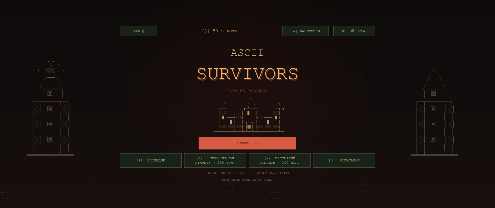
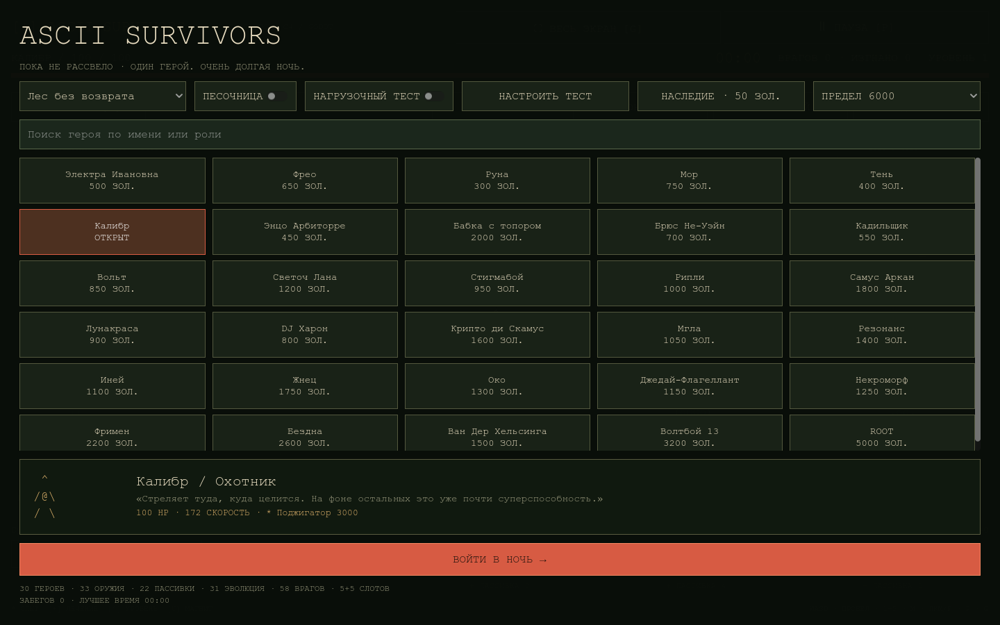
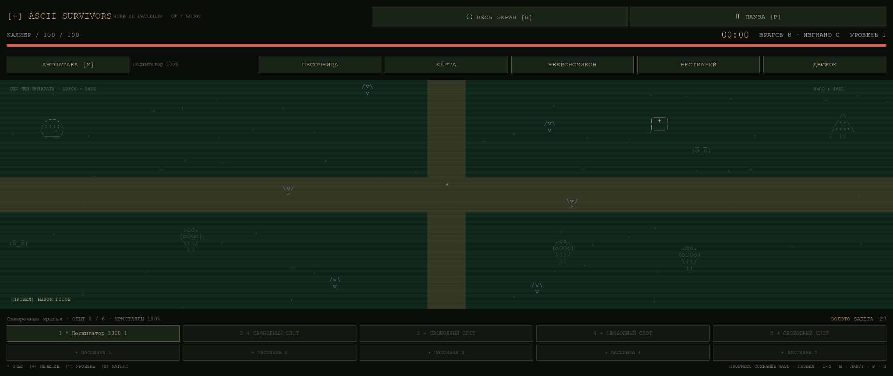
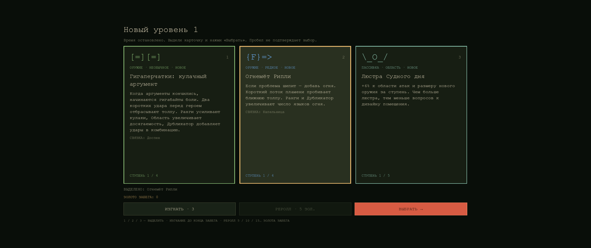

# ASCII Survivors — Godot + C# / Windows

Нативный перенос текущей JS-игры: **30 героев, 33 оружия, 22 пассивки, 58 врагов, 31 эволюция**, лес и кладбище. Есть бесконечные волны, боссы с кольцом и атаками, сундук с выбором одной из трёх наград, 5+5 слотов, платные рероллы, Наследие, карта, Бестиарий, Некрономикон и песочница. Интерфейс и ASCII-отрисовка работают в Godot; боевая логика написана на C#.

## Играть

Распакуйте **весь** архив `ASCII-Survivors-Windows.zip` и запустите **`ASCII-Survivors.exe`**. Папку `data_AsciiSurvivors_windows_x86_64` оставьте рядом с EXE: внутри код и среда .NET. Редактор и отдельная установка .NET для готовой сборки не нужны. Сборка предназначена для Windows x64.

| Клавиши | Действие |
| --- | --- |
| WASD / стрелки | Движение; герой смотрит по направлению движения |
| Пробел | Рывок; не подтверждает усиление |
| 1–5 | Выбор оружия; в меню наград 1–3 выделяют карточку |
| M | Автоматический / ручной огонь |
| ЛКМ / F | Ручная атака в сторону указателя |
| P / Escape | Пауза |
| G / F11 | Полный экран |

Поле расширяется под пропорции экрана без боковых полос и растягивания ASCII-символов. Окно усилений ограничивает ширину карточек для чтения, располагает текст сверху и держит действия сразу под карточками.

Усиление подтверждается кнопкой **«Выбрать»**. Реролл стоит 5 → 10 → 15… золота текущего забега. В песочнице доступны все герои, оружие, эволюции и враги; она не меняет обычный прогресс. Неуязвимость включается отдельно.

## Главное меню

**Играть → выбор героя → выбор карты → Войти в ночь.** У героев есть ASCII-портреты, описание, характеристики с учётом Наследия и стартовый набор оружия. Закрытого героя можно рассмотреть и купить за золото. Сохранённый забег продолжается отдельной кнопкой на главном экране.

Наследие, Некрономикон и Бестиарий доступны из главного меню. Песочница и нагрузочный тест находятся в разделе **«Испытания»**. Кнопка «Играть» запускает обычный режим, даже если перед этим был тест. Пауза и экран смерти занимают компактные блоки по центру; заголовок, ASCII-портрет и итоги забега на экране смерти также выровнены по центру.

[Матрица совместимости всех оружий и пассивок](../docs/PASSIVE_AUDIT.md). Дупликатор даёт +1 снаряд, клинок, книгу или отдельный удар за ранг; катушке добавляет отдельную цепь разрядов, кнуту — дополнительную горизонтальную полосу. Круговые ауры и щит не размножаются.

## Сохранения и перенос профиля

Godot сохраняет профиль и текущий бой в `%APPDATA%/ASCII Survivors/state.json`. Есть автосохранение каждые 5 секунд, при паузе, выборе награды и закрытии окна, а также резервная копия `.bak`. В «Наследии» можно экспортировать и восстановить JSON-копию.

Для переноса из браузера откройте **Наследие → Экспорт профиля для Godot · JSON** на сайте. Затем в ПК-версии: **Наследие → Импорт профиля / копии…**. Переносятся золото, открытые герои, постоянные улучшения, разделы и статистика. Импорт заменяет локальный профиль после подтверждения. Сам исходный JSON не меняется.

**Незавершённый бой из JS не конвертируется**; его можно продолжить в браузере. Бои, сохранённые в Godot, возобновляются в Godot, включая незаконченный выбор награды и цену реролла. Автоматической синхронизации между сайтом и приложением нет.

## Разработка

Нужны **Godot 4.7.2 .NET** и **.NET SDK 8 или новее**. Обычный Godot без .NET не подходит. Официальная загрузка: <https://godotengine.org/download/windows/>.

Откройте `project.godot` в .NET-редакторе, соберите C# и запустите проект. Либо из PowerShell:

```powershell
.\Run.ps1 -Godot 'C:\Tools\Godot\Godot_v4.7.2-stable_mono_win64_console.exe'
.\Run.ps1 -Godot $env:GODOT4 -Mode Verify
.\Run.ps1 -Godot $env:GODOT4 -Mode Smoke
.\Run.ps1 -Godot $env:GODOT4 -Mode Export
```

Для Export сначала установите **.NET export templates 4.7.2** через редактор Godot. Результат находится в `Builds/Windows`, архив — в `Builds/ASCII-Survivors-Windows.zip`. Если EXE уже запущен, задайте другую папку: `-Mode Export -OutputDirectory C:\Builds\ASCII-Survivors-new`. Это позволяет собрать обновление без закрытия игры.

В GitHub Actions workflow **Godot Windows** проверяет C#, собирает Windows-версию и прикладывает её к запуску как artifact.

Общие каталоги остаются в `../data/*.json`: имена, описания, стартовые оружия, параметры врагов, пассивки и рецепты редактируются в одном месте для двух версий. MSBuild копирует их в `Data/`; экспорт включает эти JSON в PCK. `Data/`, `.godot/` и `Builds/` не коммитятся. Механики при изменениях нужно обновлять и в JS, и в C#.

## Проверки и границы переноса

- `-- --verify`: 3322 проверки, включая 64 эталона обычных/эволюционировавших атак из JS, совместимость пассивок со всеми 33 оружиями в обоих режимах и эволюциях, все стартовые наборы, волны, атаки боссов, кольца, награды, сохранения и откат при ошибке записи. Работает и в экспортированном EXE.
- `-- --smoke-test=<абсолютная папка>`: настоящий рендер Godot: главное меню, переходы герой → карта → забег и назад, блокировка закрытых героев, продолжение сохранения, изоляция испытаний, компактная пауза, арена, сундук, атаки босса, огненные снаряды Поджигатора, вращающееся кадило, Дупликатор 0/3 на кнуте, катушке и монтировке, семь размеров окна (960×640 — 3440×1440) и полный экран. Проверяется совпадение пропорций окна/viewport без чёрных полос, полная ширина поля, размещение текста карточек и близость кнопок выбора. Снимки и `resolutions.json` записываются в указанную папку; сохранение изолировано от основного профиля.
- `node Tests/export-reference.cjs`: обновление эталонов из JS. Пересматривать изменения фикстуры перед коммитом, а не принимать их автоматически.

Фиксированный шаг симуляции — 60 Гц, отрисовка — по частоте окна. Не создаётся отдельный Godot-узел на каждого врага; симуляция использует пространственную сетку, отрисовка отсекает объекты за экраном. Для больших толп ограничен перебор соседей, переиспользуются ячейки сетки и объединяются перекрывающиеся символы обычных врагов; все враги продолжают участвовать в бою. [Замеры до/после и команды нагрузочного теста](../docs/GODOT_PERFORMANCE.md). Кооператив пока не реализован. Полноценный получасовой игровой и нагрузочный прогон на разных ПК ещё предстоит; численное сравнение атак не гарантирует побитового совпадения всего забега с JS.








